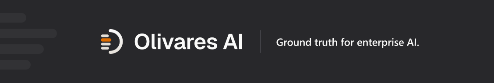
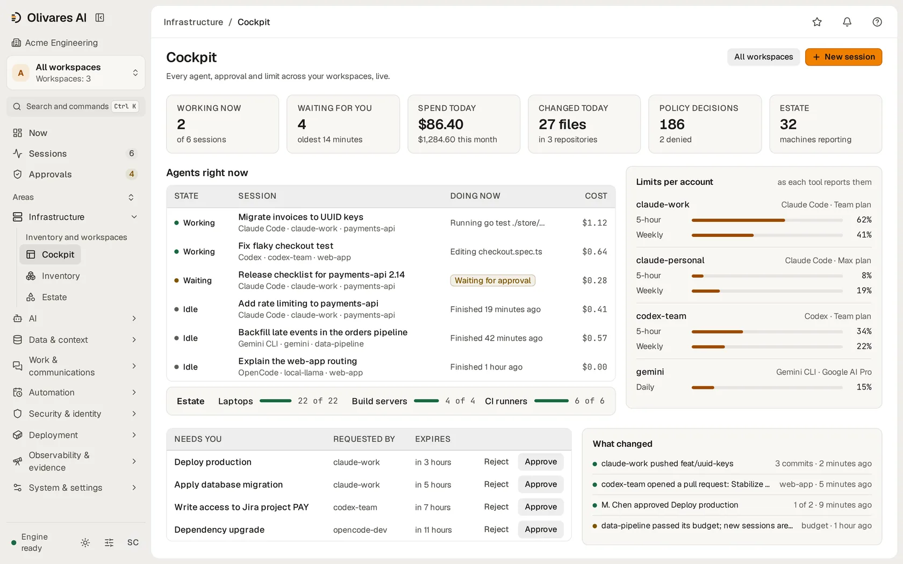
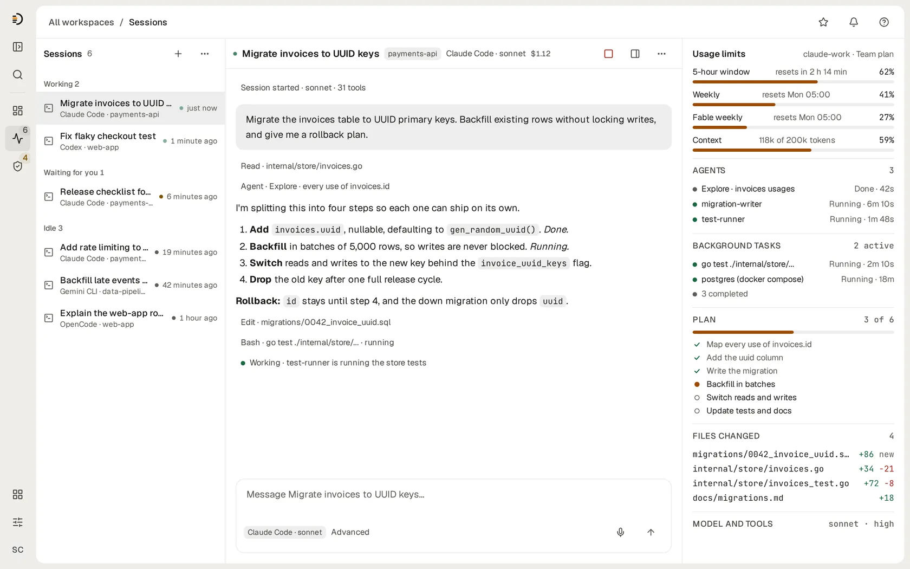
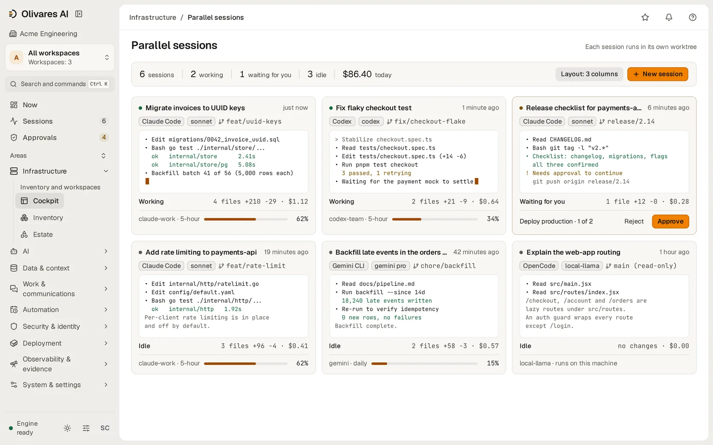
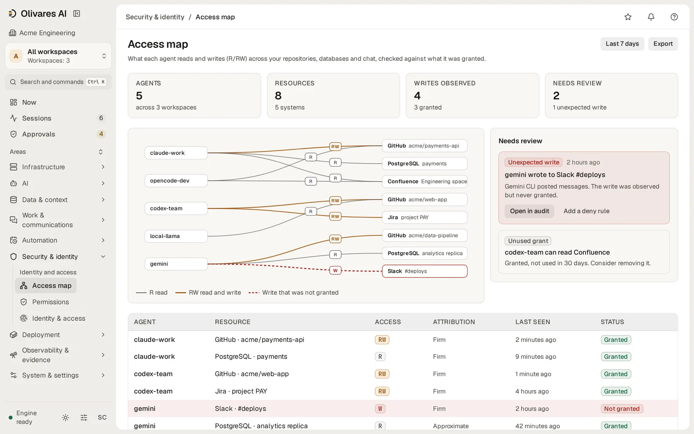
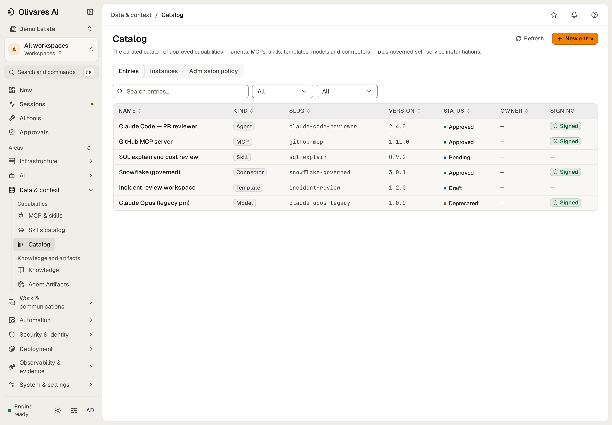
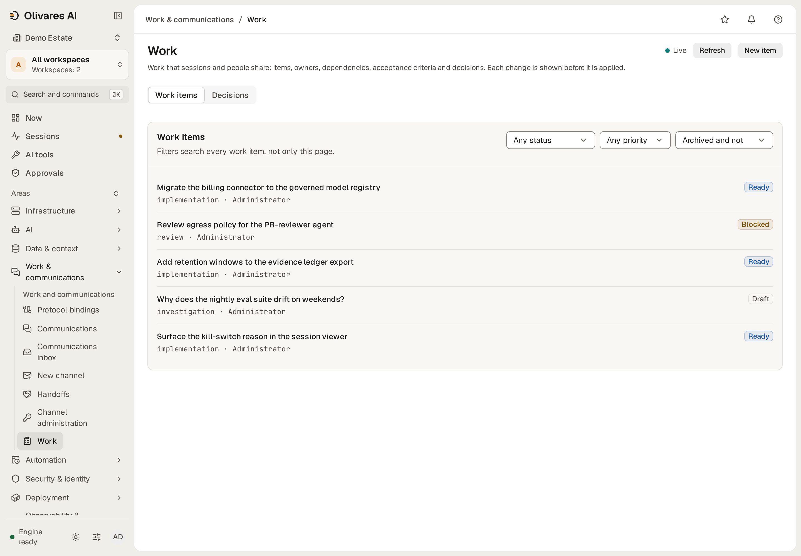

<div align="center">

<a href="https://olivares.ai"></a>

**Langues :** [English](./README.md) · [Español](./README.es.md) · [简体中文](./README.zh.md) · [Русский](./README.ru.md) · [日本語](./README.ja.md) · [Deutsch](./README.de.md) · **Français**

**Exécutez l'IA que votre équipe utilise déjà, avec le même contrôle que sur le reste de votre infrastructure.**

[Ce qu'il fait](#ce-quil-fait) · [Installation](#installation) · [Éditions](#éditions-et-tarifs) · [Documentation](#documentation) · [Communauté](#communauté) · [olivares.ai](https://olivares.ai)

[](LICENSING.md)
[](LICENSING.md) <!-- release -->
[](https://github.com/olivaresai/olivares/releases/tag/0.5)<!-- /release -->
[](CHANGELOG.md)
[](CODE_OF_CONDUCT.md)

</div>


Vos développeurs travaillent avec Claude Code et Codex. Les agents appellent des serveurs MCP, des modèles et des API internes, et les tâches planifiées s'exécutent seules. Chaque composant a ses propres journaux et permissions. Des questions simples restent donc sans réponse rapide : quel agent a modifié ce fichier, qui l'a approuvé, combien l'IA nous a-t-elle coûté ce mois-ci ?

Olivares AI rassemble les réponses au même endroit. Il se connecte aux agents et aux outils que vous utilisez déjà, montre ce que chacun fait, applique vos règles avant l'exécution d'une action et conserve un enregistrement signé de tout. C'est un seul programme qui tourne sur vos propres serveurs. Le produit complet est gratuit et open source.

<div align="center">
<picture>
  <source media="(prefers-color-scheme: dark)" srcset=".github/assets/console-cockpit-dark.webp">
  
</picture>
<br><sub><b>Cockpit</b> — ce que fait chaque agent en ce moment, les approbations qui vous attendent et les limites d'usage de chaque compte.</sub>
<br><br>
<picture>
  <source media="(prefers-color-scheme: dark)" srcset=".github/assets/console-session-dark.webp">
  
</picture>
<br><sub><b>Session</b> — la conversation à côté de son plan, des agents, des tâches en arrière-plan, des fichiers modifiés et des limites d'usage.</sub>
<br><br>
<picture>
  <source media="(prefers-color-scheme: dark)" srcset=".github/assets/console-parallel-sessions-dark.webp">
  
</picture>
<br><sub><b>Sessions en parallèle</b> — six agents au travail côte à côte, chacun dans sa propre branche, avec sa dernière sortie, son coût et sa limite d'usage.</sub>
<br><br>
<picture>
  <source media="(prefers-color-scheme: dark)" srcset=".github/assets/console-access-map-dark.webp">
  
</picture>
<br><sub><b>Carte d'accès</b> — ce que chaque agent lit et écrit, comparé à ce qui lui a été accordé.</sub>
</div>

<div align="center">

<br><sub><b>Catalogue</b>: agents, serveurs MCP, skills et connecteurs approuvés, chacun avec son statut et sa signature.</sub>
<br><br>

<br><sub><b>Travail</b>: tâches, responsables et décisions qui restent quand une session se termine.</sub>
</div>

## Ce qu'il fait

- **Savoir ce qui tourne.** Tous les agents, sessions, modèles, serveurs MCP et outils dans un seul inventaire. La carte d'accès montre ce que chacun lit et écrit, et signale les accès qu'aucune règle n'autorise.
- **Arrêter une action avant qu'elle ne cause des dégâts.** Olivares AI dispose de **quatre points d'application fermés par défaut (deny-closed)** qui vérifient chaque action avant son exécution : dans Claude Code, dans le proxy de modèles, à chaque appel d'outil MCP et entre agents. Une action risquée attend une deuxième personne ; une action interdite ne s'exécute pas. Un seul interrupteur arrête tous les agents à la fois. Si une vérification ne peut pas trancher, l'action ne s'exécute pas.
- **Maîtriser les dépenses d'IA.** Les budgets par équipe, agent ou modèle avertissent, ralentissent ou arrêtent les dépenses avant l'arrivée de la facture.
- **Donner aux agents un accès sûr aux connaissances de votre entreprise.** Connectez Google Drive, Confluence, Notion, Snowflake, S3 et PostgreSQL ; Business ajoute SharePoint, SAP et Salesforce. Chaque agent ne voit que ce que la personne qui l'utilise est autorisée à voir.
- **Poursuivre le travail entre les sessions.** Les tâches, les responsables et les décisions restent quand une session se termine. Démarrez, rejoignez et arrêtez des sessions Claude Code, Codex et Grok depuis le navigateur, sans SSH.
- **Fournir des preuves quand on vous les demande.** Chaque décision est inscrite dans un journal signé où toute modification ultérieure est détectable. Business Compliance Packs rattache les preuves à 26 catalogues de cadres et produit des rapports pour votre équipe de sécurité et vos auditeurs. Community conserve les preuves stockées et leurs exports JSON/CSV.

Il fonctionne avec vos outils actuels : Claude Code, Codex, Grok, Cursor, gemini-cli, opencode, OpenHands et les modèles locaux via Ollama. **32 modules** et **136 intégrations** : [tous les modules](docs-site/src/content/docs/reference/modules/overview.md) · [tous les connecteurs](connectors/README.md).

Community conserve l’observabilité locale, les paramètres enregistrés et l’export des sauvegardes. L’envoi SIEM/ITSM, la télémétrie externe et l’export de posture sont inclus dans l’édition de base Business.

**L’isolation réseau des sessions couvre les sessions Claude Code, Codex et OpenCode liées à une clé de fournisseur, ainsi que les sessions OpenCode utilisant la connexion propre de l’outil.** Une telle session n’atteint que le point de terminaison de son fournisseur, ou les hôtes de sa connexion, via un proxy propre à la session dans son propre espace de noms réseau, ou elle ne démarre pas. Pour OpenCode avec une clé de fournisseur, les hôtes reposent sur un inventaire antérieur, et non sur un tour démontré derrière le proxy. Les sessions Grok Build et les sessions à connexion de compte des autres outils peuvent encore atteindre tout hôte que le réseau autorise. Consultez [l’isolation réseau des sessions](SECURITY.md#session-network-isolation) avant d’exécuter des charges qui exigent un accès exclusif à un seul fournisseur.

## Installation

Choisissez une méthode et copiez son bloc. À la fin, `olivares quickstart` affiche l'adresse de la console et un jeton à usage unique pour créer le premier administrateur. Chaque version est signée, et chaque méthode vérifie le téléchargement avant de l'installer ([vérifier vous-même un téléchargement](INSTALL.md#verifying-a-release)).

**Linux et macOS, une commande.** Détecte votre système, vérifie la version, installe uniquement le binaire et n'utilise jamais `sudo`.

```sh
curl -fsSL https://olivares.ai/olivares/install.sh | sh
olivares quickstart
```

**Docker.** Multi-architecture. Les images de conteneur reposent sur Debian 13 slim (avec Node.js 24 pour les outils d'agent) et s'exécutent en tant qu'utilisateur non root. Écoute sur toutes les interfaces de l'hôte ; ajoutez `127.0.0.1:` avant chaque `-p` pour limiter l'accès à la machine locale.

<!-- release -->
```sh
docker pull docker.io/olivaresai/olivares:0.5 &&
img=$(docker image inspect --format '{{index .RepoDigests 0}}' docker.io/olivaresai/olivares:0.5) &&
cosign verify "$img" \
  --certificate-identity https://github.com/olivaresai/olivares/.github/workflows/release.yml@refs/tags/0.5 \
  --certificate-oidc-issuer https://token.actions.githubusercontent.com >/dev/null &&
docker run -d --name olivares -p 8443:8443 -p 8444:8444 \
  -v olivares-data:/var/lib/olivares \
  "$img" \
  serve --listen :8443 --grpc-listen :8444 --data-dir /var/lib/olivares
```
<!-- /release -->

**Docker Compose.** SQLite sur un seul nœud, avec Postgres et sauvegardes en option.

```sh
git clone --depth 1 https://github.com/olivaresai/olivares.git && cd olivares
docker compose -f deploy/compose/docker-compose.yml up --wait --wait-timeout 120
```

Les sessions travaillent dans un dossier de l’hôte : définissez `OLIVARES_PROJECT_DIR` avec son chemin absolu avant `up`, et Compose le monte sur `/project`. Sur les hôtes dont la politique AppArmor limite les espaces de noms utilisateur (Ubuntu 24.04 et versions ultérieures), chargez d’abord le profil des sessions : voir [Docker Compose](INSTALL.md#docker-compose).

**Debian et Ubuntu.** Le paquet ajoute un utilisateur `olivares` sans connexion possible et un service durci ; vous le démarrez.

<!-- release -->
```sh
curl -fsSLO "https://github.com/olivaresai/olivares/releases/download/0.5/olivares_0.5_linux_amd64.deb" \
  -fsSLO "https://github.com/olivaresai/olivares/releases/download/0.5/checksums.txt" \
  -fsSLO "https://github.com/olivaresai/olivares/releases/download/0.5/checksums.txt.sig" \
  -fsSLO "https://github.com/olivaresai/olivares/releases/download/0.5/checksums.txt.pem"
cosign verify-blob --certificate checksums.txt.pem --signature checksums.txt.sig \
  --certificate-identity https://github.com/olivaresai/olivares/.github/workflows/release.yml@refs/tags/0.5 \
  --certificate-oidc-issuer https://token.actions.githubusercontent.com checksums.txt &&
grep ' olivares_0.5_linux_amd64.deb$' checksums.txt | sha256sum -c &&
sudo dpkg -i olivares_0.5_linux_amd64.deb && sudo systemctl enable --now olivares
```
<!-- /release -->

**RHEL, Fedora et SUSE.**

<!-- release -->
```sh
curl -fsSLO "https://github.com/olivaresai/olivares/releases/download/0.5/olivares_0.5_linux_amd64.rpm" \
  -fsSLO "https://github.com/olivaresai/olivares/releases/download/0.5/checksums.txt" \
  -fsSLO "https://github.com/olivaresai/olivares/releases/download/0.5/checksums.txt.sig" \
  -fsSLO "https://github.com/olivaresai/olivares/releases/download/0.5/checksums.txt.pem"
cosign verify-blob --certificate checksums.txt.pem --signature checksums.txt.sig \
  --certificate-identity https://github.com/olivaresai/olivares/.github/workflows/release.yml@refs/tags/0.5 \
  --certificate-oidc-issuer https://token.actions.githubusercontent.com checksums.txt &&
grep ' olivares_0.5_linux_amd64.rpm$' checksums.txt | sha256sum -c &&
sudo rpm -i olivares_0.5_linux_amd64.rpm && sudo systemctl enable --now olivares
```
<!-- /release -->

**Alpine.**

<!-- release -->
```sh
curl -fsSLO "https://github.com/olivaresai/olivares/releases/download/0.5/olivares_0.5_linux_amd64.apk" \
  -fsSLO "https://github.com/olivaresai/olivares/releases/download/0.5/checksums.txt" \
  -fsSLO "https://github.com/olivaresai/olivares/releases/download/0.5/checksums.txt.sig" \
  -fsSLO "https://github.com/olivaresai/olivares/releases/download/0.5/checksums.txt.pem"
cosign verify-blob --certificate checksums.txt.pem --signature checksums.txt.sig \
  --certificate-identity https://github.com/olivaresai/olivares/.github/workflows/release.yml@refs/tags/0.5 \
  --certificate-oidc-issuer https://token.actions.githubusercontent.com checksums.txt &&
grep ' olivares_0.5_linux_amd64.apk$' checksums.txt | sha256sum -c &&
sudo apk add --allow-untrusted olivares_0.5_linux_amd64.apk && sudo rc-service olivares start
```
<!-- /release -->

Sur les serveurs ARM, utilisez `arm64` à la place de `amd64`. Tous les fichiers de la version : la <!-- release -->[page de la version](https://github.com/olivaresai/olivares/releases/tag/0.5)<!-- /release -->.

**Homebrew.** macOS et Linux.

```sh
brew install olivaresai/tap/olivares && olivares quickstart
```

**Depuis les sources.** Go 1.26+, [Task](https://taskfile.dev) et pnpm.

```sh
git clone --depth 1 https://github.com/olivaresai/olivares.git && cd olivares
task build && ./bin/olivares quickstart
```

**Réseaux hors ligne :** réunissez l'image signée, le chart et les éléments de vérification, puis [installez en environnement isolé](docs-site/src/content/docs/how-to/air-gap-install.md). **Windows** n'a pas encore de binaire natif : utilisez l'image Docker ou WSL2. Mises à niveau et retour arrière : [guide](docs-site/src/content/docs/how-to/upgrade-and-rollback.md). Toutes les options en détail : [`INSTALL.md`](INSTALL.md).

**Essayez d'abord avec les données de démonstration**, uniquement sur votre machine (le mot de passe de la démo est public) :

```sh
olivares serve --seed-demo --insecure --listen 127.0.0.1:8901 --grpc-listen 127.0.0.1:8902 --data-dir "$(mktemp -d)"
```

Ouvrez ensuite http://127.0.0.1:8901.

Helm, l’opérateur Kubernetes, Terraform, l’appliance et les artefacts de déploiement FIPS/STIG sont distribués avec Business ; l’installation hors ligne nécessite Enterprise. Le déploiement d’agents et de serveurs MCP sur l’infrastructure de l’entreprise (`olivares deploy`) est une fonction Business. Voir les [éditions](docs/editions.md).

## Éditions et tarifs

Community est le produit complet, gratuit et open source. Business ajoute ce dont une entreprise a besoin pour l'exploiter en production. Enterprise s'adresse aux groupes dont les infrastructures sont plus grandes ou soumises à réglementation.

| | **Community** | **Business** | **Enterprise** |
|---|---|---|---|
| **Prix** | Gratuit, AGPL-3.0 | 99 USD/mois ou 990 USD/an | Contrat annuel |
| **Contenu** | Le produit complet : utilisateurs illimités et les quatre points d'application deny-closed | Tout Community, plus Regulated Operations, AI Runtime Security, Compliance Packs et Identity & Scale, la licence commerciale, les mises à jour signées et le support par e-mail | Tout Business, plus davantage d'entreprises, de déploiements et de fournisseurs d'identité, des miroirs hors ligne et des conditions de support convenues avec vous |
| **Périmètre** | Un fournisseur d'identité actif | Une entreprise, une instance active à la fois | Défini dans le contrat |

**Regulated Operations** ajoute les gels légaux, le droit à l'effacement avec destruction de clé, des durées minimales de conservation réglementaires, le rapprochement des gels légaux sur les archives et des archives WORM sur Azure et GCS. **AI Runtime Security** ajoute une inspection plus approfondie de ce que les agents envoient, reçoivent et exécutent. **Compliance Packs** prépare des brouillons du registre d'information DORA et du dossier ISO/IEC 42001 pour votre auditeur. **Identity & Scale** connecte plusieurs fournisseurs d'identité à la fois et accompagne les déploiements plus grands.

[olivares.ai/pricing](https://olivares.ai/pricing) · [Ce que comprend chaque édition](docs/editions.md) · [Ce qui est ouvert et ce qui est commercial](LICENSING.md)

## Architecture

Un seul binaire Go avec la console intégrée. Il fournit une API REST, une API gRPC, la ligne de commande `olivares` et un fournisseur Terraform. Les collecteurs en périphérie (Business) tournent dans votre réseau, et les données restent dans SQLite ou PostgreSQL sur vos serveurs. [Comment tout s'articule](ARCHITECTURE.md).

## Documentation

[docs.olivares.ai](https://docs.olivares.ai) propose des guides d'installation, un guide pour chaque connecteur, des recettes de politiques courantes et la référence de l'API. Commencez par [Qu'est-ce qu'Olivares AI](docs-site/src/content/docs/start/what-is-olivares-ai.md). Ce qui fonctionne aujourd'hui et ce qui reste prévu : [Honnêteté et limites](docs-site/src/content/docs/start/honesty-and-limits.md). Versions : [GitHub](https://github.com/olivaresai/olivares/releases) · [`CHANGELOG.md`](CHANGELOG.md).

Sur le site : [produit](https://olivares.ai/product) · [solutions](https://olivares.ai/solutions) · [comment ça marche](https://olivares.ai/how-it-works) · [architecture](https://olivares.ai/architecture) · [sécurité](https://olivares.ai/security) · [confiance](https://olivares.ai/trust) · [comparer](https://olivares.ai/compare) · [démo](https://olivares.ai/demo) · [changelog](https://olivares.ai/changelog) · [statut](https://olivares.ai/status) · [feuille de route](https://olivares.ai/roadmap) · [marque](https://olivares.ai/brand) · [presse](https://olivares.ai/press).

## Sécurité

Vous avez trouvé une vulnérabilité ? Signalez-la en privé via [`SECURITY.md`](SECURITY.md). Olivares AI enregistre quel agent a accédé à quelle ressource, pas le contenu, et la consultation de cet enregistrement est elle-même journalisée. Les licences sont vérifiées hors ligne ; le cœur open source ne nous contacte jamais.

## Communauté

Les contributions sont les bienvenues. [`CONTRIBUTING.md`](CONTRIBUTING.md) explique la mise en place, le sign-off et l'intégration des connecteurs. [Code de conduite](CODE_OF_CONDUCT.md) · [Support](SUPPORT.md) · [Gouvernance](GOVERNANCE.md) · [Journal des modifications](CHANGELOG.md).

## Soutenir le projet

Olivares AI est développé ouvertement. S'il vous est utile, soutenez son développement sur GitHub Sponsors — [olivaresai](https://github.com/sponsors/olivaresai) ou [fran-olivares](https://github.com/sponsors/fran-olivares) — ou offrez-nous un café sur Ko-fi. Les sponsors qui souhaitent être cités figurent dans [`SUPPORTERS.md`](SUPPORTERS.md). Le parrainage n'est pas un contrat de support ([`SUPPORT.md`](SUPPORT.md)).

[](https://ko-fi.com/Z1R625SAD2)

## Licence

Le moteur, les modules et la console sont sous **AGPL-3.0-only** ; le SDK, les connecteurs et les clients sous **Apache-2.0**. Le code commercial est compilé séparément et ne figure pas dans ce dépôt ; licences commerciales : `enterprise@olivares.ai`. Les contributions exigent un DCO sign-off (`git commit -s`) et la [CLA](CLA.md).

> Fourni **en l'état**, sans garantie d'aucune sorte et sans responsabilité en cas de perte de données, d'interruption d'activité ou de manque à gagner. Voir [`DISCLAIMER.md`](DISCLAIMER.md).

---

<div align="center">

<picture>
  <source media="(prefers-color-scheme: dark)" srcset=".github/assets/olivares-mark-dark.svg">
  
</picture>

<sub><strong>La ground truth de l'IA d'entreprise.</strong> · <a href="https://olivares.ai">olivares.ai</a> · <a href="LICENSING.md">AGPL-3.0 + commercial</a></sub>

</div>
