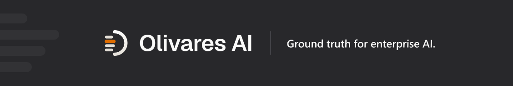
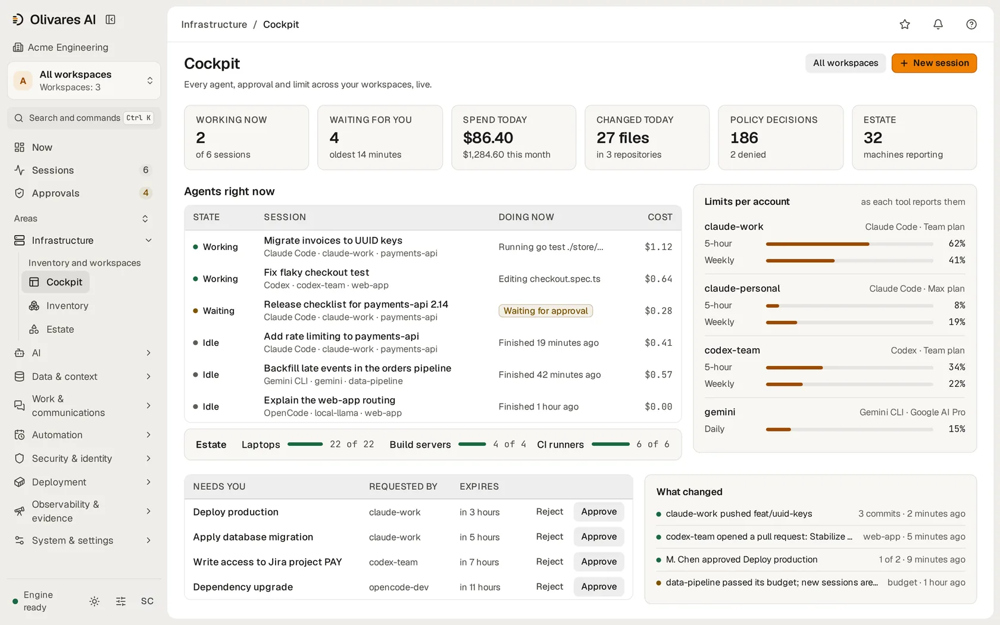
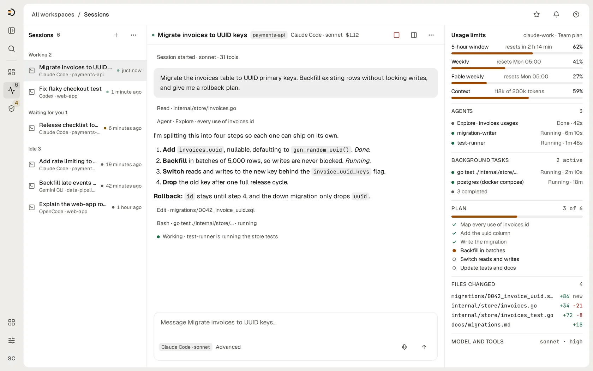
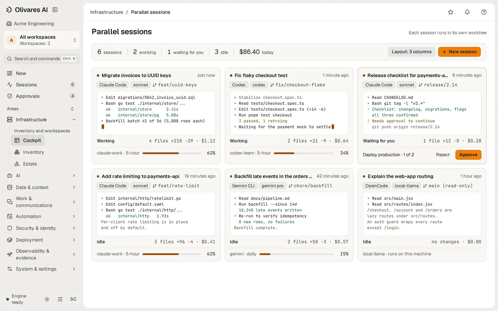
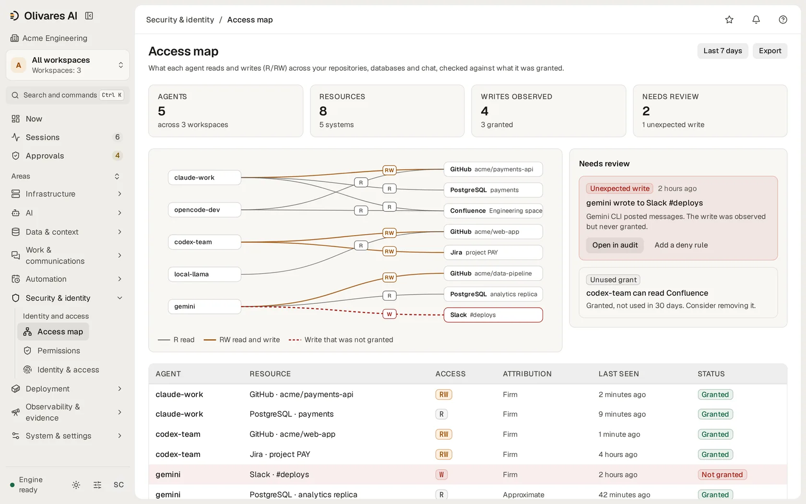
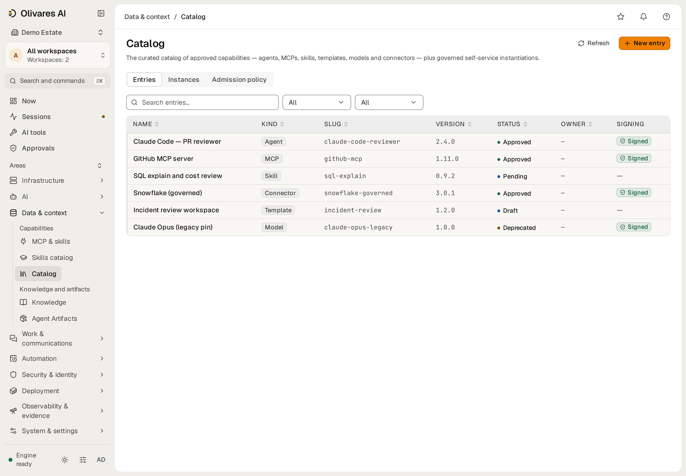
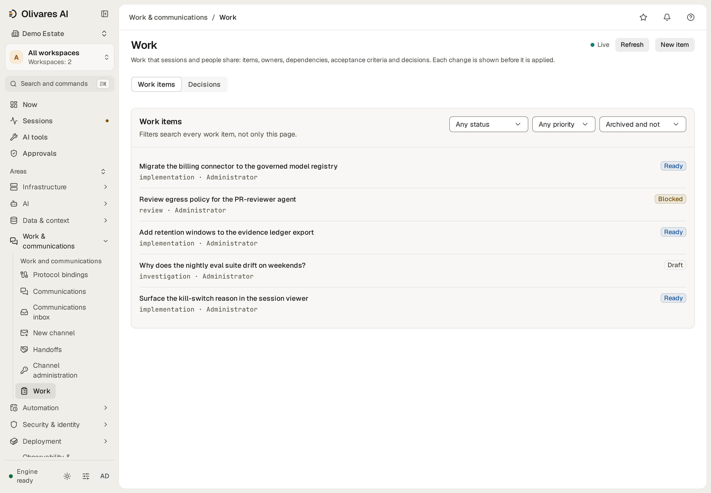

<div align="center">

<a href="https://olivares.ai"></a>

**언어:** [English](./README.md) · [Español](./README.es.md) · [简体中文](./README.zh.md) · [Русский](./README.ru.md) · [日本語](./README.ja.md) · [Deutsch](./README.de.md) · [Français](./README.fr.md) · [Українська](./README.uk.md) · **한국어** · [Português](./README.pt.md)

**팀이 이미 쓰고 있는 AI를, 나머지 인프라와 똑같은 수준으로 통제하며 운영하세요.**

[주요 기능](#주요-기능) · [설치](#설치) · [에디션](#에디션과-가격) · [문서](#문서) · [커뮤니티](#커뮤니티) · [olivares.ai](https://olivares.ai)

[](LICENSING.md)
[](LICENSING.md) <!-- release -->
[](https://github.com/olivaresai/olivares/releases/tag/0.7)<!-- /release -->
[](CHANGELOG.md)
[](CODE_OF_CONDUCT.md)

</div>

개발자는 Claude Code와 Codex로 작업합니다. 에이전트는 MCP 서버, 모델, 내부 API를 호출하고, 예약된 작업은 저절로 실행됩니다. 각 구성 요소가 자체 로그와 자체 권한을 가지고 있어서 간단한 질문에도 바로 답할 수 없습니다. 이 파일을 바꾼 에이전트는 무엇인지, 누가 승인했는지, 이번 달에 AI에 얼마를 썼는지 같은 질문입니다.

Olivares AI는 이 질문에 한곳에서 답합니다. 이미 쓰고 있는 에이전트와 도구에 연결하고, 각각이 하는 일을 보여 주고, 작업이 실행되기 전에 규칙을 적용하며, 모든 것을 서명된 기록으로 남깁니다. 자체 서버에서 실행되는 단일 프로그램이며, 완전한 제품을 무료 오픈 소스로 제공합니다.

<div align="center">
<picture>
  <source media="(prefers-color-scheme: dark)" srcset=".github/assets/console-cockpit-dark.webp">
  
</picture>
<br><sub><b>콕핏</b> — 모든 에이전트가 지금 하는 일, 승인을 기다리는 항목, 계정별 사용량 한도.</sub>
<br><br>
<picture>
  <source media="(prefers-color-scheme: dark)" srcset=".github/assets/console-session-dark.webp">
  
</picture>
<br><sub><b>세션</b> — 대화 옆에 계획, 에이전트, 백그라운드 작업, 변경된 파일, 사용량 한도.</sub>
<br><br>
<picture>
  <source media="(prefers-color-scheme: dark)" srcset=".github/assets/console-parallel-sessions-dark.webp">
  
</picture>
<br><sub><b>병렬 세션</b> — 에이전트 6개가 나란히 작업하며, 각자 자기 브랜치에서 최근 출력, 비용, 사용량 한도를 보여 줍니다.</sub>
<br><br>
<picture>
  <source media="(prefers-color-scheme: dark)" srcset=".github/assets/console-access-map-dark.webp">
  
</picture>
<br><sub><b>액세스 맵</b> — 각 에이전트가 읽고 쓰는 항목을 부여된 권한과 대조해 확인합니다.</sub>
</div>

<div align="center">

<br><sub><b>카탈로그</b>: 승인된 에이전트, MCP 서버, 스킬, 커넥터와 각각의 상태, 서명 여부.</sub>
<br><br>

<br><sub><b>작업</b>: 세션이 끝나도 남는 작업, 담당자, 결정.</sub>
</div>

[지원 도구](docs-site/src/content/docs/reference/supported-tools.md) (영어): 통합 깊이, 여러 에이전트를 한 작업에 경쟁시키기, 리뷰와 배포.

## 주요 기능

- **무엇이 실행 중인지 파악합니다.** 모든 에이전트, 세션, 모델, MCP 서버, 도구를 하나의 인벤토리에서 봅니다. 액세스 맵은 각각이 읽고 쓰는 항목을 보여 주고, 어떤 규칙도 허용하지 않은 접근을 표시합니다.
- **피해가 생기기 전에 작업을 멈춥니다.** Olivares AI에는 작업이 실행되기 전에 각각을 검사하는 **4개의 deny-closed 시행 지점**이 있습니다. Claude Code 안, 모델 프록시, 모든 MCP 도구 호출, 에이전트 사이입니다. 위험한 작업은 두 번째 사람을 기다리고, 금지된 작업은 실행되지 않으며, 스위치 하나로 모든 에이전트를 한 번에 멈춥니다. 검사가 판단하지 못하면 그 작업은 실행되지 않습니다.
- **AI 지출을 관리합니다.** Community는 모든 세션의 비용을 보여 줍니다. Business FinOps의 팀, 에이전트, 모델별 예산은 청구서가 오기 전에 지출을 경고하고, 늦추거나, 멈춥니다.
- **회사의 지식을 에이전트에 안전하게 제공합니다.** Google Drive, Confluence, Notion, Snowflake, S3, PostgreSQL을 연결하고, Business는 SharePoint, SAP, Salesforce를 더합니다. 각 에이전트는 그 뒤에 있는 사람이 볼 수 있는 것만 봅니다.
- **세션이 바뀌어도 작업을 이어 갑니다.** 세션이 끝나도 작업, 담당자, 결정은 남습니다. SSH 없이 브라우저에서 Claude Code, Codex, Grok 세션을 시작하고, 참여하고, 중지합니다.
- **요청받을 때 증거를 보여 줍니다.** 모든 결정은 변조 여부를 확인할 수 있는 서명된 로그에 기록됩니다. Business Compliance Packs는 증거를 26개 프레임워크 카탈로그에 매핑하고 보안 팀과 감사인을 위한 보고서를 만듭니다. Community는 저장된 증거와 JSON/CSV 내보내기를 계속 제공합니다.

이미 쓰고 있는 도구와 함께 동작합니다. Claude Code, Codex, Grok, Cursor, gemini-cli, opencode, OpenHands, 그리고 Ollama를 통한 로컬 모델입니다. **32개 모듈**과 **136개 통합**이 있습니다. [모든 모듈](docs-site/src/content/docs/reference/modules/overview.md) · [모든 커넥터](connectors/README.md).

Community는 로컬 옵저버빌리티, 저장된 설정, 백업 내보내기를 제공합니다. SIEM/ITSM 푸시, 외부 텔레메트리 전송, 태세 내보내기, 액티브-패시브 HA 리더 라우팅, 엣지 컬렉터는 Business 기본 에디션에 포함됩니다.

세션의 네트워크 격리는 도구와 연결 방식에 따라 다릅니다. Claude Code, Codex, OpenCode, Gemini CLI의 프로바이더 키 세션과 지원되는 OpenCode, Cursor 계정 세션에는 네임스페이스/프록시 경계가 있습니다. Grok Build와 다른 계정 세션에는 없습니다. 정확한 범위와 증거의 한계는 [지원 도구와 격리 한계](docs-site/src/content/docs/reference/supported-tools.md#confinement-depends-on-the-connection)를 참조하세요.

## 설치

방법 하나를 골라 해당 블록을 복사하세요. 마지막에 `olivares quickstart`가 콘솔 주소와 첫 번째 관리자를 만들 때 쓰는 일회용 토큰을 출력합니다. 모든 릴리스에는 서명이 있고, 각 방법은 내려받은 파일을 설치하기 전에 검증합니다([다운로드를 직접 검증하기](INSTALL.md#verifying-a-release)).

**Linux와 macOS, 명령 하나.** 시스템을 감지하고, 릴리스를 검증하고, 바이너리만 설치하며, `sudo`를 쓰지 않습니다.

```sh
curl -fsSL https://olivares.ai/olivares/install.sh | sh
olivares quickstart
```

**Docker.** 멀티 아키텍처입니다. 컨테이너 이미지는 Debian 13 slim(에이전트 도구용 Node.js 24 포함)을 기반으로 하며 root가 아닌 사용자로 실행됩니다. 호스트의 모든 인터페이스에서 수신 대기합니다. 로컬로 제한하려면 각 `-p` 앞에 `127.0.0.1:`을 붙이세요.

<!-- release -->
```sh
docker pull docker.io/olivaresai/olivares:0.7 &&
img=$(docker image inspect --format '{{index .RepoDigests 0}}' docker.io/olivaresai/olivares:0.7) &&
cosign verify "$img" \
  --certificate-identity https://github.com/olivaresai/olivares/.github/workflows/release.yml@refs/tags/0.7 \
  --certificate-oidc-issuer https://token.actions.githubusercontent.com >/dev/null &&
docker run --rm --entrypoint cat "$img" /usr/share/olivares/olivares-sessions.json >olivares-sessions.json &&
apparmor= &&
if grep -qsw userns_create /sys/kernel/security/apparmor/features/namespaces/mask; then
  docker run --rm --entrypoint cat "$img" /usr/share/olivares/olivares-sessions.conf |
    sudo tee /etc/apparmor.d/olivares-sessions >/dev/null &&
  sudo apparmor_parser -r /etc/apparmor.d/olivares-sessions &&
  apparmor=--security-opt=apparmor=olivares-sessions
fi &&
docker run -d --name olivares --hostname olivares -p 8443:8443 -p 8444:8444 \
  --security-opt no-new-privileges --security-opt seccomp=olivares-sessions.json $apparmor \
  -v olivares-data:/var/lib/olivares \
  "$img" \
  serve --listen :8443 --grpc-listen :8444 --data-dir /var/lib/olivares
```
<!-- /release -->

세션에는 검증된 이미지에 들어 있는 프로파일이 필요합니다. seccomp 프로파일은 항상 필요하고, AppArmor가 사용자 네임스페이스를 제어하는 호스트(Debian 13, Ubuntu 24.04 이상)에서는 AppArmor 프로파일도 필요하며, 위 명령 블록이 `sudo`로 불러옵니다. [Docker](INSTALL.md#docker)를 참조하세요.

**Docker Compose.** 단일 노드의 SQLite이며, Postgres와 백업은 선택 사항입니다.

```sh
git clone --depth 1 https://github.com/olivaresai/olivares.git && cd olivares &&
if grep -qsw userns_create /sys/kernel/security/apparmor/features/namespaces/mask; then
  sudo install -m 0644 deploy/apparmor/olivares-sessions.conf /etc/apparmor.d/olivares-sessions &&
  sudo apparmor_parser -r /etc/apparmor.d/olivares-sessions &&
  export OLIVARES_APPARMOR_PROFILE=olivares-sessions
fi &&
docker compose -f deploy/compose/docker-compose.yml up --wait --wait-timeout 120
```

세션은 호스트의 폴더 하나에서 작업합니다. `up` 전에 `OLIVARES_PROJECT_DIR`을 그 절대 경로로 설정하면 Compose가 `/project`에 마운트합니다. AppArmor가 사용자 네임스페이스를 제어하는 호스트(Debian 13, Ubuntu 24.04 이상)에서는 이 블록이 먼저 세션용 AppArmor 프로파일을 `sudo`로 불러옵니다. [Docker Compose](INSTALL.md#docker-compose)를 참조하세요.

**Debian과 Ubuntu.** 패키지는 로그인할 수 없는 `olivares` 사용자와 보안을 강화한 서비스를 추가하며, 서비스는 직접 시작합니다.

<!-- release -->
```sh
curl -fsSLO "https://github.com/olivaresai/olivares/releases/download/0.7/olivares_0.7_linux_amd64.deb" \
  -fsSLO "https://github.com/olivaresai/olivares/releases/download/0.7/checksums.txt" \
  -fsSLO "https://github.com/olivaresai/olivares/releases/download/0.7/checksums.txt.sig" \
  -fsSLO "https://github.com/olivaresai/olivares/releases/download/0.7/checksums.txt.pem"
cosign verify-blob --certificate checksums.txt.pem --signature checksums.txt.sig \
  --certificate-identity https://github.com/olivaresai/olivares/.github/workflows/release.yml@refs/tags/0.7 \
  --certificate-oidc-issuer https://token.actions.githubusercontent.com checksums.txt &&
grep ' olivares_0.7_linux_amd64.deb$' checksums.txt | sha256sum -c &&
sudo dpkg -i olivares_0.7_linux_amd64.deb && sudo systemctl enable --now olivares
```
<!-- /release -->

**RHEL, Fedora, SUSE.**

<!-- release -->
```sh
curl -fsSLO "https://github.com/olivaresai/olivares/releases/download/0.7/olivares_0.7_linux_amd64.rpm" \
  -fsSLO "https://github.com/olivaresai/olivares/releases/download/0.7/checksums.txt" \
  -fsSLO "https://github.com/olivaresai/olivares/releases/download/0.7/checksums.txt.sig" \
  -fsSLO "https://github.com/olivaresai/olivares/releases/download/0.7/checksums.txt.pem"
cosign verify-blob --certificate checksums.txt.pem --signature checksums.txt.sig \
  --certificate-identity https://github.com/olivaresai/olivares/.github/workflows/release.yml@refs/tags/0.7 \
  --certificate-oidc-issuer https://token.actions.githubusercontent.com checksums.txt &&
grep ' olivares_0.7_linux_amd64.rpm$' checksums.txt | sha256sum -c &&
sudo rpm -i olivares_0.7_linux_amd64.rpm && sudo systemctl enable --now olivares
```
<!-- /release -->

**Alpine.**

<!-- release -->
```sh
curl -fsSLO "https://github.com/olivaresai/olivares/releases/download/0.7/olivares_0.7_linux_amd64.apk" \
  -fsSLO "https://github.com/olivaresai/olivares/releases/download/0.7/checksums.txt" \
  -fsSLO "https://github.com/olivaresai/olivares/releases/download/0.7/checksums.txt.sig" \
  -fsSLO "https://github.com/olivaresai/olivares/releases/download/0.7/checksums.txt.pem"
cosign verify-blob --certificate checksums.txt.pem --signature checksums.txt.sig \
  --certificate-identity https://github.com/olivaresai/olivares/.github/workflows/release.yml@refs/tags/0.7 \
  --certificate-oidc-issuer https://token.actions.githubusercontent.com checksums.txt &&
grep ' olivares_0.7_linux_amd64.apk$' checksums.txt | sha256sum -c &&
sudo apk add --allow-untrusted olivares_0.7_linux_amd64.apk && sudo rc-service olivares start
```
<!-- /release -->

ARM 서버에서는 `amd64` 대신 `arm64`를 사용하세요. 릴리스의 모든 파일은 <!-- release -->[릴리스 페이지](https://github.com/olivaresai/olivares/releases/tag/0.7)<!-- /release -->에 있습니다.

**Homebrew.** macOS와 Linux.

```sh
brew install olivaresai/tap/olivares && olivares quickstart
```

**소스에서 빌드.** Go 1.26 이상, [Task](https://taskfile.dev), pnpm.

```sh
git clone --depth 1 https://github.com/olivaresai/olivares.git && cd olivares
task build && ./bin/olivares quickstart
```

**오프라인 네트워크:** 서명된 이미지, 차트, 검증 자료를 묶어 [폐쇄망에 설치](docs-site/src/content/docs/how-to/air-gap-install.md)하세요. **Windows**에는 아직 네이티브 빌드가 없으니 Docker 이미지나 WSL2를 사용하세요. 업그레이드와 롤백: [사용 방법](docs-site/src/content/docs/how-to/upgrade-and-rollback.md). 모든 옵션의 자세한 내용: [`INSTALL.md`](INSTALL.md).

**먼저 데모 데이터로 체험해 보세요.** 내 컴퓨터에서만 실행하세요(데모 비밀번호는 공개되어 있습니다).

```sh
olivares serve --seed-demo --insecure --listen 127.0.0.1:8901 --grpc-listen 127.0.0.1:8902 --data-dir "$(mktemp -d)"
```

그런 다음 http://127.0.0.1:8901 을 여세요.

Helm, Kubernetes 오퍼레이터, Terraform, 어플라이언스, FIPS/STIG 배포 산출물은 Business와 함께 제공되고, 폐쇄망 설치에는 Enterprise가 필요하며, 거버넌스 상태의 폐쇄망 DDIL 전송은 Business 기능입니다. 회사 인프라에 에이전트와 MCP 서버를 배포하는 것(`olivares deploy`)은 Business 기능입니다. [에디션](docs/editions.md)을 참조하세요.

## 에디션과 가격

Community는 완전한 제품이며 무료 오픈 소스입니다. Business는 회사가 프로덕션에서 운영하는 데 필요한 것을 더합니다. Enterprise는 규모가 더 크거나 규제를 받는 에스테이트를 가진 그룹을 위한 에디션입니다.

| | **Community** | **Business** | **Enterprise** |
|---|---|---|---|
| **가격** | 무료, AGPL-3.0 | 월 USD 99 또는 연 USD 990 | 연간 계약 |
| **제공 내용** | 완전한 제품: 사용자 수 무제한과 모든 4개의 deny-closed 시행 지점 | Community의 모든 것과 Regulated Operations, AI Runtime Security, Compliance Packs, Identity & Scale, 상용 라이선스, 서명된 업데이트, 이메일 지원 | Business의 모든 것과 더 많은 회사, 배포, ID 프로바이더, 오프라인 미러, 별도로 합의한 지원 조건 |
| **범위** | 활성 ID 프로바이더 하나 | 회사 하나, 한 번에 활성 인스턴스 하나 | 계약에서 합의 |

**Regulated Operations**는 법적 보존, 키 파기를 동반한 삭제권, 규제상의 최소 보존 기간, 아카이브에 대한 법적 보존 대조, Azure와 GCS의 WORM 아카이브를 더합니다. **AI Runtime Security**는 에이전트가 보내고, 받고, 실행하는 것을 더 깊이 검사합니다. **Compliance Packs**는 프레임워크 평가, 규제 뷰, OSCAL 내보내기, 요청 시 생성하는 HTML/PDF 보고서를 제공하고, 감사인을 위한 DORA 정보 등록부와 ISO/IEC 42001 팩의 초안을 작성합니다. **Identity & Scale**은 여러 ID 프로바이더를 동시에 연결하고 더 큰 배포 규모에 맞춰 확장됩니다.

[에디션 비교 및 구매](https://olivares.ai/pricing) · [각 에디션의 포함 내용](docs/editions.md) · [무엇이 오픈이고 무엇이 상용인가](LICENSING.md)

## 아키텍처

콘솔이 내장된 Go 바이너리 하나입니다. REST API, gRPC API, `olivares` 명령줄을 제공합니다. Terraform 프로바이더는 Business와 함께 제공됩니다. 엣지 컬렉터(Business)는 네트워크 안에서 실행되고, 데이터는 자체 서버의 SQLite 또는 PostgreSQL에 남습니다. [전체 구성](ARCHITECTURE.md).

## 문서

[docs.olivares.ai](https://docs.olivares.ai)에는 설치 가이드, 모든 커넥터의 가이드, 자주 쓰는 정책의 레시피, API 레퍼런스가 있습니다. [Olivares AI란 무엇인가](docs-site/src/content/docs/start/what-is-olivares-ai.md)부터 시작하세요. 오늘 동작하는 것과 아직 계획 중인 것: [정직성과 한계](docs-site/src/content/docs/start/honesty-and-limits.md). 릴리스: [GitHub](https://github.com/olivaresai/olivares/releases) · [`CHANGELOG.md`](CHANGELOG.md).

웹사이트: [제품](https://olivares.ai/product) · [솔루션](https://olivares.ai/solutions) · [작동 방식](https://olivares.ai/how-it-works) · [아키텍처](https://olivares.ai/architecture) · [보안](https://olivares.ai/security) · [신뢰](https://olivares.ai/trust) · [비교](https://olivares.ai/compare) · [데모](https://olivares.ai/demo) · [변경 내역](https://olivares.ai/changelog) · [상태](https://olivares.ai/status) · [로드맵](https://olivares.ai/roadmap) · [브랜드](https://olivares.ai/brand) · [보도 자료](https://olivares.ai/press).

## 보안

취약점을 발견하셨나요? [`SECURITY.md`](SECURITY.md)를 통해 비공개로 신고하세요. Olivares AI는 어떤 에이전트가 어떤 리소스에 접근했는지를 기록하며, 내용은 기록하지 않습니다. 그 기록을 여는 것 자체도 로그에 남습니다. 라이선스는 오프라인으로 확인하며, 오픈 소스 코어는 우리에게 연락하지 않습니다.

## 커뮤니티

기여를 환영합니다. [`CONTRIBUTING.md`](CONTRIBUTING.md)에 설정 방법, 서명 확인(sign-off), 커넥터를 넣는 방법이 있습니다. [행동 강령](CODE_OF_CONDUCT.md) · [지원](SUPPORT.md) · [거버넌스](GOVERNANCE.md) · [변경 내역](CHANGELOG.md).

## 프로젝트 후원

Olivares AI는 공개적으로 개발됩니다. 도움이 되었다면 GitHub Sponsors로 개발을 후원하거나 Ko-fi로 후원해 주세요. 이름을 밝히기를 원하는 후원자는 [`SUPPORTERS.md`](SUPPORTERS.md)에 올라갑니다. 후원은 지원 계약이 아닙니다([`SUPPORT.md`](SUPPORT.md)).

[](https://github.com/sponsors/olivaresai)
[](https://ko-fi.com/Z1R625SAD2)

## 라이선스

엔진, 모듈, 콘솔은 **AGPL-3.0-only**이고, SDK, 커넥터, 클라이언트는 **Apache-2.0**입니다. 상용 코드는 따로 빌드되며 이 저장소에 없습니다. 상용 라이선스 문의: `enterprise@olivares.ai`. 기여에는 DCO sign-off(`git commit -s`)와 [CLA](CLA.md)가 필요합니다.

> **있는 그대로** 제공되며, 어떠한 종류의 보증도 없고 데이터 손실, 영업 중단, 이익 손실에 대한 책임도 지지 않습니다. [`DISCLAIMER.md`](DISCLAIMER.md)를 참조하세요.

---

<div align="center">

<picture>
  <source media="(prefers-color-scheme: dark)" srcset=".github/assets/olivares-mark-dark.svg">
  
</picture>

<sub><strong>기업 AI를 위한 그라운드 트루스.</strong> · <a href="https://olivares.ai">olivares.ai</a> · <a href="LICENSING.md">AGPL-3.0 + commercial</a></sub>

</div>
