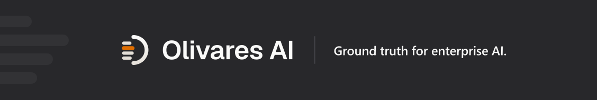
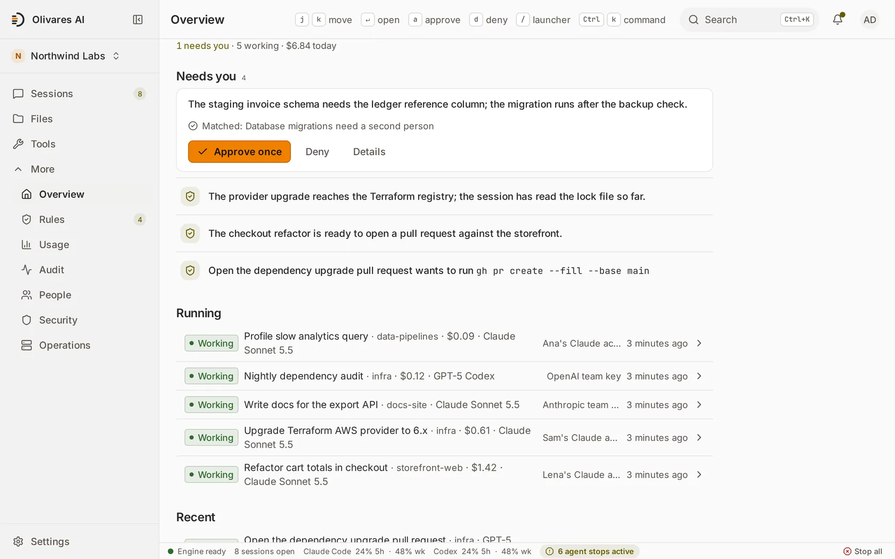
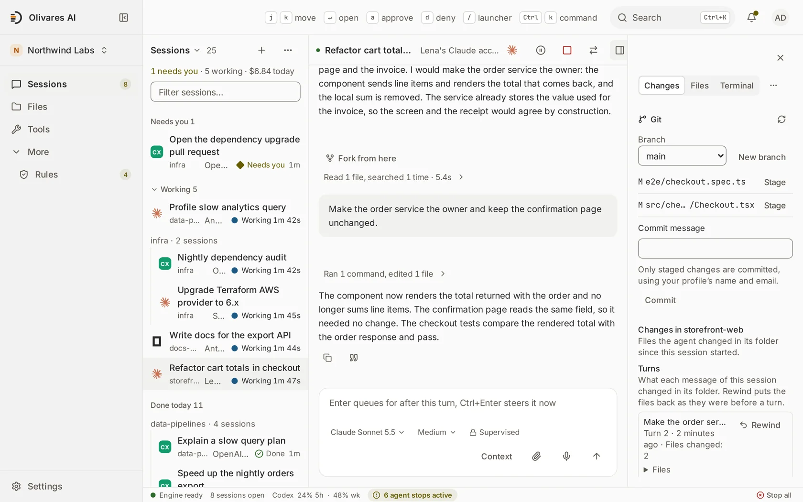

<div align="center">

<a href="https://olivares.ai"></a>

**Idiomas:** [English](./README.md) · [Español](./README.es.md) · [简体中文](./README.zh.md) · [Русский](./README.ru.md) · [日本語](./README.ja.md) · [Deutsch](./README.de.md) · [Français](./README.fr.md) · [Українська](./README.uk.md) · [한국어](./README.ko.md) · **Português**

**Execute a IA que a sua equipa já utiliza, com o mesmo controlo que tem sobre o resto da infraestrutura.**

[O que faz](#o-que-faz) · [Instalação](#instalação) · [Edições](#edições-e-preços) · [Documentação](#documentação) · [Comunidade](#comunidade) · [olivares.ai](https://olivares.ai)

[](LICENSING.md)
[](LICENSING.md) <!-- release -->
[](https://github.com/olivaresai/olivares/releases/tag/0.7)<!-- /release -->
[](CHANGELOG.md)
[](CODE_OF_CONDUCT.md)

</div>

Os seus programadores trabalham com Claude Code e Codex. Os agentes chamam servidores MCP, modelos e APIs internas, e as tarefas agendadas correm por si próprias. Cada peça guarda os seus próprios registos e as suas próprias permissões, pelo que perguntas simples não têm resposta rápida: que agente alterou este ficheiro, quem o aprovou, quanto nos custou a IA este mês?

O Olivares AI responde-lhes num só lugar. Liga-se aos agentes e às ferramentas que já utiliza, mostra o que cada um faz, aplica as suas regras antes de uma ação ser executada e mantém um registo assinado de tudo. É um único programa que corre nos seus próprios servidores, e o produto completo é gratuito e de código aberto.

<div align="center">
<picture>
  <source media="(prefers-color-scheme: dark)" srcset=".github/assets/console-overview-dark.webp">
  
</picture>
<br><sub><b>Visão geral</b>: o que aguarda a sua aprovação, segundo as suas regras, e cada agente em trabalho com o seu custo.</sub>
<br><br>
<picture>
  <source media="(prefers-color-scheme: dark)" srcset=".github/assets/console-changed-files-dark.webp">
  
</picture>
<br><sub><b>Sessão</b>: a conversa ao lado dos ficheiros que alterou.</sub>
</div>

[Ferramentas suportadas](docs-site/src/content/docs/reference/supported-tools.md) (em inglês): profundidade da integração, pôr vários agentes a competir numa mesma tarefa, revisão e entrega.

## O que faz

- **Saber o que está em execução.** Todos os agentes, sessões, modelos, servidores MCP e ferramentas num único inventário. O mapa de acessos mostra o que cada um lê e escreve, e assinala os acessos que nenhuma regra permite.
- **Parar uma ação antes que cause danos.** O Olivares AI tem **quatro pontos de aplicação deny-closed** que verificam cada ação antes de ser executada: dentro do Claude Code, no proxy de modelos, em cada chamada a uma ferramenta MCP e entre agentes. Uma ação arriscada aguarda por uma segunda pessoa, uma ação proibida não é executada, e um único interruptor para todos os agentes de uma vez. Quando uma verificação não consegue decidir, a ação não é executada.
- **Manter a despesa em IA sob controlo.** O Community mostra o custo de cada sessão. Os orçamentos de FinOps do Business, por equipa, agente ou modelo, avisam, abrandam ou param a despesa antes de a fatura chegar.
- **Dar aos agentes o conhecimento da empresa, em segurança.** Ligue o Google Drive, o Notion, o S3 e o PostgreSQL; o Business acrescenta Confluence, Snowflake, Azure AI Search, SharePoint, SAP e Salesforce. Cada agente vê apenas o que a pessoa por trás dele está autorizada a ver.
- **Manter o trabalho em curso entre sessões.** Tarefas, responsáveis e decisões mantêm-se quando uma sessão termina. Inicie, junte-se a e pare sessões do Claude Code, do Codex e do Grok a partir do navegador, sem SSH.
- **Mostrar provas quando alguém as pedir.** Cada decisão fica num registo assinado, que torna detetável qualquer alteração posterior. Os Compliance Packs do Business associam as evidências a 26 catálogos de frameworks e produzem relatórios para a sua equipa de segurança e para os auditores. O Community conserva as evidências guardadas e as respetivas exportações JSON/CSV.

Funciona com as ferramentas que já tem: Claude Code, Codex, Grok, Cursor, gemini-cli, opencode, OpenHands e modelos locais através do Ollama. **32 módulos** e **136 integrações**: [todos os módulos](docs-site/src/content/docs/reference/modules/overview.md) · [todos os conectores](connectors/README.md).

O Community mantém a observabilidade local, as definições guardadas e a exportação de cópias de segurança. O envio SIEM/ITSM, a entrega de telemetria externa, a exportação de postura, o encaminhamento para o líder de HA ativo-passivo e o coletor de periferia estão incluídos na edição base do Business.

O isolamento de rede das sessões depende da ferramenta e da ligação. As sessões com chave de fornecedor do Claude Code, do Codex, do OpenCode e do Gemini CLI, bem como as sessões de conta suportadas do OpenCode e do Cursor, têm uma fronteira de espaço de nomes e de proxy. O Grok Build e as restantes sessões de conta não. Consulte as [ferramentas suportadas e os limites de confinamento](docs-site/src/content/docs/reference/supported-tools.md#confinement-depends-on-the-connection) para saber o âmbito exato e os limites das provas.

## Instalação

Escolha um método e copie o respetivo bloco. No fim, `olivares quickstart` mostra o endereço da consola e um token de utilização única para criar o primeiro administrador. Todas as versões são assinadas, e cada método verifica o que transfere antes de o instalar ([verificar uma transferência por si](INSTALL.md#verifying-a-release)).

**Linux e macOS, um só comando.** Deteta o seu sistema, verifica a versão, instala apenas o binário e nunca usa `sudo`.

```sh
curl -fsSL https://olivares.ai/olivares/install.sh | sh
olivares quickstart
```

**Docker.** Multiarquitetura. As imagens de contentor baseiam-se no Debian 13 slim (com Node.js 24 para as ferramentas de agente) e correm como utilizador sem privilégios de root. Escuta em todas as interfaces do anfitrião; coloque `127.0.0.1:` antes de cada `-p` para o manter local.

<!-- release -->
```sh
docker pull docker.io/olivaresai/olivares:0.7 &&
img=$(docker image inspect --format '{{index .RepoDigests 0}}' docker.io/olivaresai/olivares:0.7) &&
cosign verify "$img" \
  --certificate-identity https://github.com/olivaresai/olivares/.github/workflows/release.yml@refs/tags/0.7 \
  --certificate-oidc-issuer https://token.actions.githubusercontent.com >/dev/null &&
docker run --rm --entrypoint cat "$img" /usr/share/olivares/olivares-sessions.json >olivares-sessions.json &&
apparmor= &&
if grep -qsw userns_create /sys/kernel/security/apparmor/features/namespaces/mask; then
  docker run --rm --entrypoint cat "$img" /usr/share/olivares/olivares-sessions.conf |
    sudo tee /etc/apparmor.d/olivares-sessions >/dev/null &&
  sudo apparmor_parser -r /etc/apparmor.d/olivares-sessions &&
  apparmor=--security-opt=apparmor=olivares-sessions
fi &&
docker run -d --name olivares --hostname olivares -p 8443:8443 -p 8444:8444 \
  --security-opt no-new-privileges --security-opt seccomp=olivares-sessions.json $apparmor \
  -v olivares-data:/var/lib/olivares \
  "$img" \
  serve --listen :8443 --grpc-listen :8444 --data-dir /var/lib/olivares
```
<!-- /release -->

As sessões precisam dos perfis que a imagem verificada inclui: o seccomp sempre, e o AppArmor, que o bloco de comandos acima carrega com `sudo`, nos anfitriões cujo AppArmor controla os espaços de nomes de utilizador (Debian 13, Ubuntu 24.04 e posteriores). Consulte [Docker](INSTALL.md#docker).

**Docker Compose.** SQLite num único nó, com Postgres e cópias de segurança opcionais.

```sh
git clone --depth 1 https://github.com/olivaresai/olivares.git && cd olivares &&
if grep -qsw userns_create /sys/kernel/security/apparmor/features/namespaces/mask; then
  sudo install -m 0644 deploy/apparmor/olivares-sessions.conf /etc/apparmor.d/olivares-sessions &&
  sudo apparmor_parser -r /etc/apparmor.d/olivares-sessions &&
  export OLIVARES_APPARMOR_PROFILE=olivares-sessions
fi &&
docker compose -f deploy/compose/docker-compose.yml up --wait --wait-timeout 120
```

As sessões trabalham numa pasta do anfitrião: defina `OLIVARES_PROJECT_DIR` com o respetivo caminho absoluto antes de `up`, e o Compose monta-a em `/project`. Nos anfitriões cujo AppArmor controla os espaços de nomes de utilizador (Debian 13, Ubuntu 24.04 e posteriores), o bloco carrega primeiro o perfil AppArmor das sessões com `sudo`: consulte [Docker Compose](INSTALL.md#docker-compose).

**Debian e Ubuntu.** O pacote acrescenta um utilizador `olivares` sem início de sessão e um serviço reforçado; é o utilizador que o inicia.

<!-- release -->
```sh
curl -fsSLO "https://github.com/olivaresai/olivares/releases/download/0.7/olivares_0.7_linux_amd64.deb" \
  -fsSLO "https://github.com/olivaresai/olivares/releases/download/0.7/checksums.txt" \
  -fsSLO "https://github.com/olivaresai/olivares/releases/download/0.7/checksums.txt.sig" \
  -fsSLO "https://github.com/olivaresai/olivares/releases/download/0.7/checksums.txt.pem"
cosign verify-blob --certificate checksums.txt.pem --signature checksums.txt.sig \
  --certificate-identity https://github.com/olivaresai/olivares/.github/workflows/release.yml@refs/tags/0.7 \
  --certificate-oidc-issuer https://token.actions.githubusercontent.com checksums.txt &&
grep ' olivares_0.7_linux_amd64.deb$' checksums.txt | sha256sum -c &&
sudo dpkg -i olivares_0.7_linux_amd64.deb && sudo systemctl enable --now olivares
```
<!-- /release -->

**RHEL, Fedora e SUSE.**

<!-- release -->
```sh
curl -fsSLO "https://github.com/olivaresai/olivares/releases/download/0.7/olivares_0.7_linux_amd64.rpm" \
  -fsSLO "https://github.com/olivaresai/olivares/releases/download/0.7/checksums.txt" \
  -fsSLO "https://github.com/olivaresai/olivares/releases/download/0.7/checksums.txt.sig" \
  -fsSLO "https://github.com/olivaresai/olivares/releases/download/0.7/checksums.txt.pem"
cosign verify-blob --certificate checksums.txt.pem --signature checksums.txt.sig \
  --certificate-identity https://github.com/olivaresai/olivares/.github/workflows/release.yml@refs/tags/0.7 \
  --certificate-oidc-issuer https://token.actions.githubusercontent.com checksums.txt &&
grep ' olivares_0.7_linux_amd64.rpm$' checksums.txt | sha256sum -c &&
sudo rpm -i olivares_0.7_linux_amd64.rpm && sudo systemctl enable --now olivares
```
<!-- /release -->

**Alpine.**

<!-- release -->
```sh
curl -fsSLO "https://github.com/olivaresai/olivares/releases/download/0.7/olivares_0.7_linux_amd64.apk" \
  -fsSLO "https://github.com/olivaresai/olivares/releases/download/0.7/checksums.txt" \
  -fsSLO "https://github.com/olivaresai/olivares/releases/download/0.7/checksums.txt.sig" \
  -fsSLO "https://github.com/olivaresai/olivares/releases/download/0.7/checksums.txt.pem"
cosign verify-blob --certificate checksums.txt.pem --signature checksums.txt.sig \
  --certificate-identity https://github.com/olivaresai/olivares/.github/workflows/release.yml@refs/tags/0.7 \
  --certificate-oidc-issuer https://token.actions.githubusercontent.com checksums.txt &&
grep ' olivares_0.7_linux_amd64.apk$' checksums.txt | sha256sum -c &&
sudo apk add --allow-untrusted olivares_0.7_linux_amd64.apk && sudo rc-service olivares start
```
<!-- /release -->

Em servidores ARM, utilize `arm64` em vez de `amd64`. Todos os ficheiros da versão: <!-- release -->[página da versão](https://github.com/olivaresai/olivares/releases/tag/0.7)<!-- /release -->.

**Homebrew.** macOS e Linux.

```sh
brew install olivaresai/tap/olivares && olivares quickstart
```

**A partir do código-fonte.** Go 1.26+, [Task](https://taskfile.dev) e pnpm.

```sh
git clone --depth 1 https://github.com/olivaresai/olivares.git && cd olivares
task build && ./bin/olivares quickstart
```

**Redes isoladas (air-gapped):** reúna a imagem assinada, o chart e o material de verificação e, depois, [instale em ambiente isolado](docs-site/src/content/docs/how-to/air-gap-install.md). O **Windows** ainda não tem uma compilação nativa: utilize a imagem Docker ou o WSL2. Atualizações e reversão: [guia](docs-site/src/content/docs/how-to/upgrade-and-rollback.md). Todas as opções em detalhe: [`INSTALL.md`](INSTALL.md).

**Experimente primeiro com dados de demonstração**, apenas na sua máquina (a palavra-passe da demonstração é pública):

```sh
olivares serve --seed-demo --insecure --listen 127.0.0.1:8901 --grpc-listen 127.0.0.1:8902 --data-dir "$(mktemp -d)"
```

Depois, abra http://127.0.0.1:8901.

O Helm, o operador Kubernetes, o Terraform, o appliance e os artefactos de implementação FIPS/STIG são distribuídos com o Business; a instalação em ambiente isolado exige o Enterprise; a transferência DDIL em ambiente isolado do estado de governação é uma funcionalidade do Business. A implementação de agentes e servidores MCP na infraestrutura da empresa (`olivares deploy`) é uma funcionalidade do Business. Consulte as [edições](docs/editions.md).

## Edições e preços

O Community é o produto completo, gratuito e de código aberto. O Business acrescenta o que uma empresa precisa para o executar em produção. O Enterprise destina-se a grupos com parques maiores ou regulados.

| | **Community** | **Business** | **Enterprise** |
|---|---|---|---|
| **Preço** | Gratuito, AGPL-3.0 | USD 99/mês ou USD 990/ano | Contrato anual |
| **O que inclui** | O produto completo: utilizadores ilimitados e os quatro pontos de aplicação deny-closed | Tudo o que o Community inclui, mais Regulated Operations, AI Runtime Security, Compliance Packs e Identity & Scale, a licença comercial, atualizações assinadas e suporte por correio eletrónico | Tudo o que o Business inclui, mais empresas, implementações e fornecedores de identidade adicionais, réplicas offline e condições de suporte acordadas consigo |
| **Âmbito** | Um fornecedor de identidade ativo | Uma empresa, uma instância ativa de cada vez | Acordado no contrato |

O **Regulated Operations** acrescenta retenções legais, direito ao apagamento com destruição de chaves, limites mínimos regulamentares de conservação, reconciliação de retenções legais nos arquivos e arquivos WORM no Azure e no GCS. O **AI Runtime Security** acrescenta uma inspeção mais profunda do que os agentes enviam, recebem e executam. Os **Compliance Packs** disponibilizam avaliações de frameworks, vistas regulamentares, exportação OSCAL e relatórios HTML/PDF a pedido, e elaboram rascunhos do registo de informação do DORA e do pacote ISO/IEC 42001 para o seu auditor. O **Identity & Scale** liga vários fornecedores de identidade em simultâneo e acompanha o crescimento de implementações maiores.

[Comparar edições e comprar](https://olivares.ai/pricing) · [O que cada edição inclui](docs/editions.md) · [O que é aberto e o que é comercial](LICENSING.md)

## Arquitetura

Um único binário Go com a consola integrada. Disponibiliza uma API REST, uma API gRPC e a linha de comandos `olivares`. O fornecedor Terraform é distribuído com o Business. Os coletores de periferia (Business) correm dentro da sua rede, e os dados ficam em SQLite ou PostgreSQL nos seus servidores. [Como tudo se articula](ARCHITECTURE.md).

## Documentação

O [docs.olivares.ai](https://docs.olivares.ai) tem guias de instalação, um guia para cada conector, receitas para políticas comuns e a referência da API. Comece por [O que é o Olivares AI](docs-site/src/content/docs/start/what-is-olivares-ai.md). O que funciona hoje e o que ainda está previsto: [Honestidade e limites](docs-site/src/content/docs/start/honesty-and-limits.md). Versões: [GitHub](https://github.com/olivaresai/olivares/releases) · [`CHANGELOG.md`](CHANGELOG.md).

No sítio web: [produto](https://olivares.ai/product) · [soluções](https://olivares.ai/solutions) · [como funciona](https://olivares.ai/how-it-works) · [arquitetura](https://olivares.ai/architecture) · [segurança](https://olivares.ai/security) · [confiança](https://olivares.ai/trust) · [comparar](https://olivares.ai/compare) · [demonstração](https://olivares.ai/demo) · [registo de alterações](https://olivares.ai/changelog) · [estado](https://olivares.ai/status) · [roteiro](https://olivares.ai/roadmap) · [marca](https://olivares.ai/brand) · [imprensa](https://olivares.ai/press).

## Segurança

Encontrou uma vulnerabilidade? Comunique-a em privado através de [`SECURITY.md`](SECURITY.md). O Olivares AI regista que agente tocou em que recurso, não o conteúdo, e a abertura desse registo fica, ela própria, registada. As licenças são verificadas offline; o núcleo de código aberto nunca nos contacta.

## Comunidade

As contribuições são bem-vindas. O [`CONTRIBUTING.md`](CONTRIBUTING.md) explica a preparação do ambiente, o sign-off e como se integram os conectores. [Código de conduta](CODE_OF_CONDUCT.md) · [Suporte](SUPPORT.md) · [Governação](GOVERNANCE.md) · [Registo de alterações](CHANGELOG.md).

## Apoiar o projeto

O Olivares AI é desenvolvido de forma aberta. Se lhe for útil, apoie o seu desenvolvimento no GitHub Sponsors ou ofereça-nos um café no Ko-fi. Os patrocinadores que queiram ser nomeados figuram em [`SUPPORTERS.md`](SUPPORTERS.md). O patrocínio não é um contrato de suporte ([`SUPPORT.md`](SUPPORT.md)).

[](https://github.com/sponsors/olivaresai)
[](https://ko-fi.com/Z1R625SAD2)

## Licença

O motor, os módulos e a consola são **AGPL-3.0-only**; o SDK, os conectores e os clientes são **Apache-2.0**. O código comercial é compilado em separado e não está neste repositório; licenciamento comercial: `enterprise@olivares.ai`. As contribuições exigem um sign-off DCO (`git commit -s`) e o [CLA](CLA.md).

> Fornecido **no estado em que se encontra**, sem garantia de qualquer tipo e sem responsabilidade por perda de dados, interrupção da atividade ou lucros cessantes. Consulte [`DISCLAIMER.md`](DISCLAIMER.md).

---

<div align="center">

<picture>
  <source media="(prefers-color-scheme: dark)" srcset=".github/assets/olivares-mark-dark.svg">
  
</picture>

<sub><strong>Ground truth para a IA empresarial.</strong> · <a href="https://olivares.ai">olivares.ai</a> · <a href="LICENSING.md">AGPL-3.0 + commercial</a></sub>

</div>
