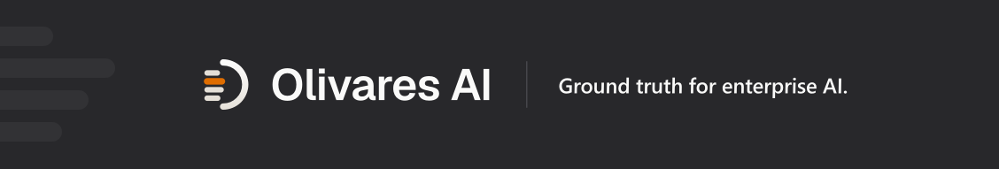
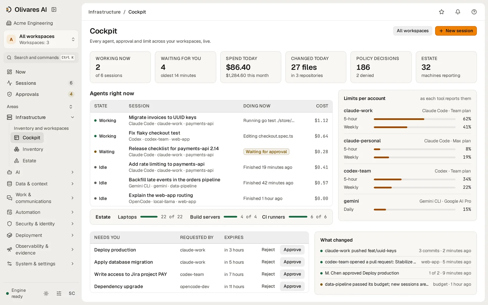
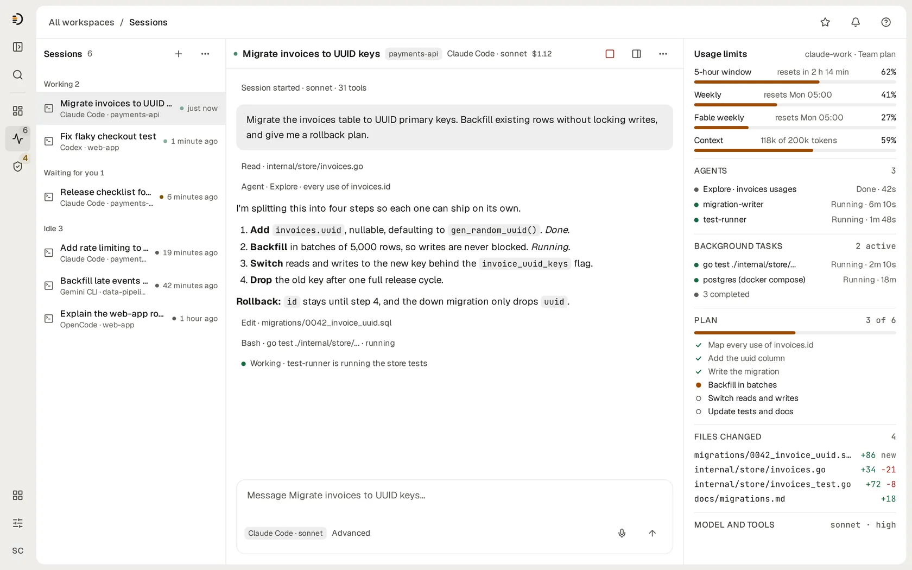
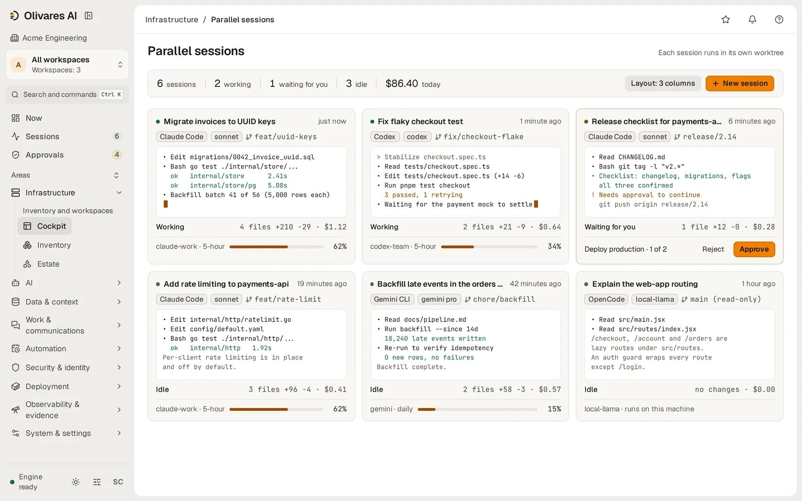
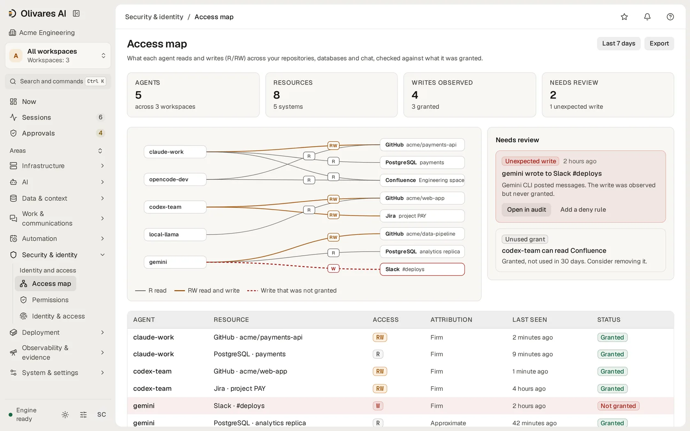
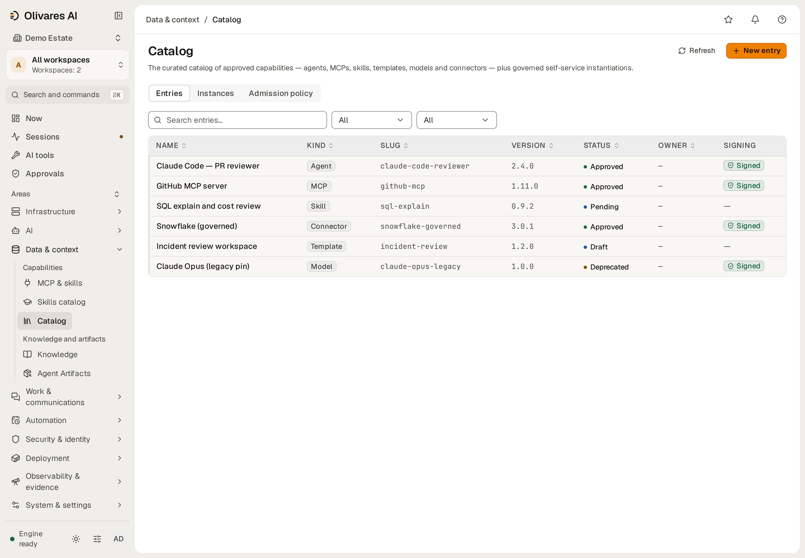
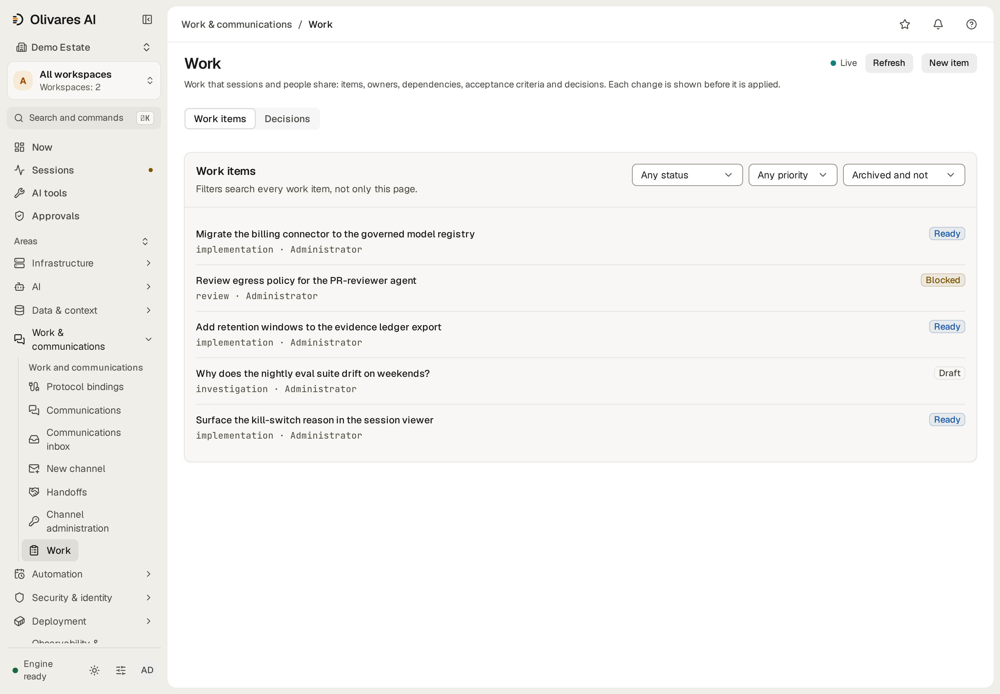

<div align="center">

<a href="https://olivares.ai"></a>

**Мови:** [English](./README.md) · [Español](./README.es.md) · [简体中文](./README.zh.md) · [Русский](./README.ru.md) · [日本語](./README.ja.md) · [Deutsch](./README.de.md) · [Français](./README.fr.md) · **Українська** · [한국어](./README.ko.md) · [Português](./README.pt.md)

**Запускайте ШІ, яким ваша команда вже користується, з таким самим контролем, як і над рештою вашої інфраструктури.**

[Що це робить](#що-це-робить) · [Встановлення](#встановлення) · [Редакції](#редакції-та-ціни) · [Документація](#документація) · [Community](#community) · [olivares.ai](https://olivares.ai)

[](LICENSING.md)
[](LICENSING.md) <!-- release -->
[](https://github.com/olivaresai/olivares/releases/tag/0.7)<!-- /release -->
[](CHANGELOG.md)
[](CODE_OF_CONDUCT.md)

</div>

Ваші розробники працюють із Claude Code і Codex. Агенти звертаються до MCP-серверів, моделей і внутрішніх API, а заплановані завдання виконуються самостійно. Кожен компонент веде власні журнали й має власні дозволи, тому на прості запитання немає швидкої відповіді: який агент змінив цей файл, хто його затвердив, скільки нам коштував ШІ цього місяця?

Olivares AI відповідає на них в одному місці. Він підключається до агентів та інструментів, якими ви вже користуєтеся, показує, що робить кожен із них, застосовує ваші правила до того, як дія виконається, і веде підписаний запис усього. Це єдина програма, що працює на ваших власних серверах, а повний продукт безкоштовний і має відкритий код.

<div align="center">
<picture>
  <source media="(prefers-color-scheme: dark)" srcset=".github/assets/console-cockpit-dark.webp">
  
</picture>
<br><sub><b>Cockpit</b> — що зараз робить кожен агент, які затвердження чекають на вас і ліміти використання кожного облікового запису.</sub>
<br><br>
<picture>
  <source media="(prefers-color-scheme: dark)" srcset=".github/assets/console-session-dark.webp">
  
</picture>
<br><sub><b>Сесія</b> — розмова поруч із планом, агентами, фоновими завданнями, зміненими файлами та лімітами використання.</sub>
<br><br>
<picture>
  <source media="(prefers-color-scheme: dark)" srcset=".github/assets/console-parallel-sessions-dark.webp">
  
</picture>
<br><sub><b>Паралельні сесії</b> — шість агентів працюють пліч-о-пліч, кожен у власній гілці, з останнім виводом, вартістю та лімітом використання.</sub>
<br><br>
<picture>
  <source media="(prefers-color-scheme: dark)" srcset=".github/assets/console-access-map-dark.webp">
  
</picture>
<br><sub><b>Карта доступу</b> — що кожен агент читає й записує, звірено з тим, що йому надано.</sub>
</div>

<div align="center">

<br><sub><b>Каталог</b>: затверджені агенти, MCP-сервери, навички та конектори, кожен зі своїм статусом і відомістю про підпис.</sub>
<br><br>

<br><sub><b>Робота</b>: завдання, власники та рішення, які зберігаються після завершення сесії.</sub>
</div>

[Підтримувані інструменти](docs-site/src/content/docs/reference/supported-tools.md) (англійською): глибина інтеграції, змагання кількох агентів над одним завданням, перегляд і випуск.

## Що це робить

- **Знати, що працює.** Усі агенти, сесії, моделі, MCP-сервери та інструменти в одному переліку. Карта доступу показує, що кожен із них читає й записує, і позначає доступ, який не дозволяє жодне правило.
- **Зупинити дію, поки вона не завдала шкоди.** Olivares AI має **чотири deny-closed точки застосування**, які перевіряють кожну дію до її виконання: усередині Claude Code, у проксі моделей, при кожному виклику інструмента MCP і між агентами. Ризикована дія чекає на другу людину, заборонена не виконується, а один перемикач зупиняє всіх агентів одразу. Якщо перевірка не може ухвалити рішення, дія не виконується.
- **Тримати витрати на ШІ під контролем.** Community показує вартість кожної сесії. Бюджети Business FinOps на команду, агента чи модель попереджають, сповільнюють або зупиняють витрати ще до надходження рахунку.
- **Безпечно надати агентам знання вашої компанії.** Підключіть Google Drive, Notion, S3 і PostgreSQL; Business додає Confluence, Snowflake, Azure AI Search, SharePoint, SAP і Salesforce. Кожен агент бачить лише те, що дозволено бачити людині, яка за ним стоїть.
- **Продовжувати роботу між сесіями.** Завдання, власники та рішення зберігаються після завершення сесії. Запускайте, приєднуйтеся до сесій Claude Code, Codex і Grok та зупиняйте їх із браузера, без SSH.
- **Показати докази, коли їх запитують.** Кожне рішення потрапляє в підписаний журнал, де видно будь-яке втручання. Business Compliance Packs зіставляють докази з 26 каталогів фреймворків і створюють звіти для вашої служби безпеки та аудиторів. Community зберігає накопичені докази та їхній експорт у JSON/CSV.

Він працює з інструментами, які у вас уже є: Claude Code, Codex, Grok, Cursor, gemini-cli, opencode, OpenHands і локальні моделі через Ollama. **32 модулі** та **136 інтеграцій**: [усі модулі](docs-site/src/content/docs/reference/modules/overview.md) · [усі конектори](connectors/README.md).

Community зберігає локальну спостережуваність, збережені налаштування й експорт резервної копії. Надсилання до SIEM/ITSM, зовнішня доставка телеметрії, експорт стану безпеки, маршрутизація лідера активно-пасивного HA та крайовий колектор входять до базової редакції Business.

Мережева ізоляція сесій залежить від інструмента та підключення. Сесії з ключем постачальника в Claude Code, Codex, OpenCode і Gemini CLI, а також підтримувані сесії облікових записів OpenCode і Cursor мають ізоляцію через простір імен і проксі. Grok Build та інші сесії облікових записів її не мають. Точний обсяг і межі доказів дивіться в розділі [підтримувані інструменти та межі ізоляції](docs-site/src/content/docs/reference/supported-tools.md#confinement-depends-on-the-connection).

## Встановлення

Виберіть один спосіб і скопіюйте його блок. Наприкінці `olivares quickstart` виводить адресу консолі та одноразовий токен для створення першого адміністратора. Кожен випуск підписано, і кожен спосіб перевіряє те, що завантажує, перш ніж це встановити ([перевірити завантаження самостійно](INSTALL.md#verifying-a-release)).

**Linux і macOS, одна команда.** Визначає вашу систему, перевіряє випуск, встановлює лише бінарний файл і ніколи не використовує `sudo`.

```sh
curl -fsSL https://olivares.ai/olivares/install.sh | sh
olivares quickstart
```

**Docker.** Multi-arch. Образи контейнерів засновані на Debian 13 slim (із Node.js 24 для інструментів агентів) і працюють від імені користувача без прав root. Він слухає на всіх інтерфейсах хоста; щоб залишити його локальним, поставте `127.0.0.1:` перед кожним `-p`.

<!-- release -->
```sh
docker pull docker.io/olivaresai/olivares:0.7 &&
img=$(docker image inspect --format '{{index .RepoDigests 0}}' docker.io/olivaresai/olivares:0.7) &&
cosign verify "$img" \
  --certificate-identity https://github.com/olivaresai/olivares/.github/workflows/release.yml@refs/tags/0.7 \
  --certificate-oidc-issuer https://token.actions.githubusercontent.com >/dev/null &&
docker run --rm --entrypoint cat "$img" /usr/share/olivares/olivares-sessions.json >olivares-sessions.json &&
apparmor= &&
if grep -qsw userns_create /sys/kernel/security/apparmor/features/namespaces/mask; then
  docker run --rm --entrypoint cat "$img" /usr/share/olivares/olivares-sessions.conf |
    sudo tee /etc/apparmor.d/olivares-sessions >/dev/null &&
  sudo apparmor_parser -r /etc/apparmor.d/olivares-sessions &&
  apparmor=--security-opt=apparmor=olivares-sessions
fi &&
docker run -d --name olivares --hostname olivares -p 8443:8443 -p 8444:8444 \
  --security-opt no-new-privileges --security-opt seccomp=olivares-sessions.json $apparmor \
  -v olivares-data:/var/lib/olivares \
  "$img" \
  serve --listen :8443 --grpc-listen :8444 --data-dir /var/lib/olivares
```
<!-- /release -->

Сесіям потрібні профілі, що постачаються з перевіреним образом: завжди профіль seccomp, а на хостах, де AppArmor контролює простори імен користувачів (Debian 13, Ubuntu 24.04 і новіші), ще й профіль AppArmor, який завантажує наведений вище блок команд через `sudo`. Дивіться [Docker](INSTALL.md#docker).

**Docker Compose.** SQLite на одному вузлі, з необов’язковими Postgres і резервними копіями.

```sh
git clone --depth 1 https://github.com/olivaresai/olivares.git && cd olivares &&
if grep -qsw userns_create /sys/kernel/security/apparmor/features/namespaces/mask; then
  sudo install -m 0644 deploy/apparmor/olivares-sessions.conf /etc/apparmor.d/olivares-sessions &&
  sudo apparmor_parser -r /etc/apparmor.d/olivares-sessions &&
  export OLIVARES_APPARMOR_PROFILE=olivares-sessions
fi &&
docker compose -f deploy/compose/docker-compose.yml up --wait --wait-timeout 120
```

Сесії працюють в одній теці хоста: перед `up` задайте `OLIVARES_PROJECT_DIR` як її абсолютний шлях, і Compose змонтує її в `/project`. На хостах, де AppArmor контролює простори імен користувачів (Debian 13, Ubuntu 24.04 і новіші), блок спершу завантажує профіль AppArmor для сесій через `sudo`: дивіться [Docker Compose](INSTALL.md#docker-compose).

**Debian і Ubuntu.** Пакет додає користувача `olivares` без можливості входу та захищену службу; запускаєте її ви.

<!-- release -->
```sh
curl -fsSLO "https://github.com/olivaresai/olivares/releases/download/0.7/olivares_0.7_linux_amd64.deb" \
  -fsSLO "https://github.com/olivaresai/olivares/releases/download/0.7/checksums.txt" \
  -fsSLO "https://github.com/olivaresai/olivares/releases/download/0.7/checksums.txt.sig" \
  -fsSLO "https://github.com/olivaresai/olivares/releases/download/0.7/checksums.txt.pem"
cosign verify-blob --certificate checksums.txt.pem --signature checksums.txt.sig \
  --certificate-identity https://github.com/olivaresai/olivares/.github/workflows/release.yml@refs/tags/0.7 \
  --certificate-oidc-issuer https://token.actions.githubusercontent.com checksums.txt &&
grep ' olivares_0.7_linux_amd64.deb$' checksums.txt | sha256sum -c &&
sudo dpkg -i olivares_0.7_linux_amd64.deb && sudo systemctl enable --now olivares
```
<!-- /release -->

**RHEL, Fedora і SUSE.**

<!-- release -->
```sh
curl -fsSLO "https://github.com/olivaresai/olivares/releases/download/0.7/olivares_0.7_linux_amd64.rpm" \
  -fsSLO "https://github.com/olivaresai/olivares/releases/download/0.7/checksums.txt" \
  -fsSLO "https://github.com/olivaresai/olivares/releases/download/0.7/checksums.txt.sig" \
  -fsSLO "https://github.com/olivaresai/olivares/releases/download/0.7/checksums.txt.pem"
cosign verify-blob --certificate checksums.txt.pem --signature checksums.txt.sig \
  --certificate-identity https://github.com/olivaresai/olivares/.github/workflows/release.yml@refs/tags/0.7 \
  --certificate-oidc-issuer https://token.actions.githubusercontent.com checksums.txt &&
grep ' olivares_0.7_linux_amd64.rpm$' checksums.txt | sha256sum -c &&
sudo rpm -i olivares_0.7_linux_amd64.rpm && sudo systemctl enable --now olivares
```
<!-- /release -->

**Alpine.**

<!-- release -->
```sh
curl -fsSLO "https://github.com/olivaresai/olivares/releases/download/0.7/olivares_0.7_linux_amd64.apk" \
  -fsSLO "https://github.com/olivaresai/olivares/releases/download/0.7/checksums.txt" \
  -fsSLO "https://github.com/olivaresai/olivares/releases/download/0.7/checksums.txt.sig" \
  -fsSLO "https://github.com/olivaresai/olivares/releases/download/0.7/checksums.txt.pem"
cosign verify-blob --certificate checksums.txt.pem --signature checksums.txt.sig \
  --certificate-identity https://github.com/olivaresai/olivares/.github/workflows/release.yml@refs/tags/0.7 \
  --certificate-oidc-issuer https://token.actions.githubusercontent.com checksums.txt &&
grep ' olivares_0.7_linux_amd64.apk$' checksums.txt | sha256sum -c &&
sudo apk add --allow-untrusted olivares_0.7_linux_amd64.apk && sudo rc-service olivares start
```
<!-- /release -->

На серверах ARM використовуйте `arm64` замість `amd64`. Усі файли випуску: <!-- release -->[сторінка випуску](https://github.com/olivaresai/olivares/releases/tag/0.7)<!-- /release -->.

**Homebrew.** macOS і Linux.

```sh
brew install olivaresai/tap/olivares && olivares quickstart
```

**З вихідного коду.** Go 1.26+, [Task](https://taskfile.dev) і pnpm.

```sh
git clone --depth 1 https://github.com/olivaresai/olivares.git && cd olivares
task build && ./bin/olivares quickstart
```

**Мережі без доступу до інтернету:** зберіть підписаний образ, чарт і матеріали для перевірки, а тоді [встановіть в ізольованому середовищі](docs-site/src/content/docs/how-to/air-gap-install.md). Для **Windows** власної збірки ще немає: використовуйте образ Docker або WSL2. Оновлення та відкат: [інструкція](docs-site/src/content/docs/how-to/upgrade-and-rollback.md). Усі варіанти докладно: [`INSTALL.md`](INSTALL.md).

**Спершу спробуйте з демонстраційними даними**, лише на своїй машині (демонстраційний пароль загальнодоступний):

```sh
olivares serve --seed-demo --insecure --listen 127.0.0.1:8901 --grpc-listen 127.0.0.1:8902 --data-dir "$(mktemp -d)"
```

Потім відкрийте http://127.0.0.1:8901.

Helm, оператор Kubernetes, Terraform, апаратний пристрій (appliance) і артефакти розгортання FIPS/STIG постачаються з Business; встановлення в ізольованому середовищі вимагає Enterprise; air-gap-передача стану врядування в режимі DDIL — можливість Business. Розгортання агентів і MCP-серверів в інфраструктурі компанії (`olivares deploy`) — можливість Business. Дивіться [редакції](docs/editions.md).

## Редакції та ціни

Community — це повний продукт, безкоштовний і з відкритим кодом. Business додає те, що потрібно компанії для роботи у виробничому середовищі. Enterprise призначено для груп компаній із більшим або регульованим парком.

| | **Community** | **Business** | **Enterprise** |
|---|---|---|---|
| **Ціна** | Безкоштовно, AGPL-3.0 | USD 99/місяць або USD 990/рік | Річний договір |
| **Що ви отримуєте** | Повний продукт: необмежена кількість користувачів і усі чотири deny-closed точки застосування | Усе з Community, а також Regulated Operations, AI Runtime Security, Compliance Packs та Identity & Scale, комерційна ліцензія, підписані оновлення та підтримка електронною поштою | Усе з Business, а також більше компаній, розгортань і постачальників ідентифікації, офлайн-дзеркала та умови підтримки, погоджені з вами |
| **Обсяг** | Один активний постачальник ідентифікації | Одна компанія, один активний екземпляр одночасно | Погоджується в договорі |

**Regulated Operations** додає юридичні утримання (legal holds), право на видалення зі знищенням ключа, нормативні мінімальні строки зберігання, зіставлення юридичних утримань в архівах і WORM-архіви в Azure та GCS. **AI Runtime Security** додає глибшу перевірку того, що агенти надсилають, отримують і виконують. **Compliance Packs** надають оцінювання за фреймворками, регуляторні подання, експорт OSCAL і звіти HTML/PDF на вимогу, а також готують чернетки реєстру інформації DORA та пакета ISO/IEC 42001 для вашого аудитора. **Identity & Scale** підключає кількох постачальників ідентифікації одночасно й зростає разом із більшими розгортаннями.

[Порівняти редакції та придбати](https://olivares.ai/pricing) · [Що входить до кожної редакції](docs/editions.md) · [Що відкрите, а що комерційне](LICENSING.md)

## Архітектура

Один бінарний файл Go зі вбудованою консоллю. Він надає REST API, gRPC API і командний рядок `olivares`. Постачальник Terraform постачається з Business. Крайові колектори (Business) працюють усередині вашої мережі, а дані залишаються в SQLite або PostgreSQL на ваших серверах. [Як усе поєднується](ARCHITECTURE.md).

## Документація

На [docs.olivares.ai](https://docs.olivares.ai) є посібники зі встановлення, настанова для кожного конектора, рецепти для поширених політик і довідник API. Почніть із [Що таке Olivares AI](docs-site/src/content/docs/start/what-is-olivares-ai.md). Що працює сьогодні, а що ще лише заплановано: [Чесність і обмеження](docs-site/src/content/docs/start/honesty-and-limits.md). Випуски: [GitHub](https://github.com/olivaresai/olivares/releases) · [`CHANGELOG.md`](CHANGELOG.md).

На вебсайті: [продукт](https://olivares.ai/product) · [рішення](https://olivares.ai/solutions) · [як це працює](https://olivares.ai/how-it-works) · [архітектура](https://olivares.ai/architecture) · [безпека](https://olivares.ai/security) · [довіра](https://olivares.ai/trust) · [порівняння](https://olivares.ai/compare) · [демо](https://olivares.ai/demo) · [журнал змін](https://olivares.ai/changelog) · [статус](https://olivares.ai/status) · [дорожня карта](https://olivares.ai/roadmap) · [бренд](https://olivares.ai/brand) · [преса](https://olivares.ai/press).

## Безпека

Знайшли вразливість? Повідомте про неї приватно через [`SECURITY.md`](SECURITY.md). Olivares AI записує, який агент звертався до якого ресурсу, але не вміст, і саме відкриття цього запису теж журналюється. Ліцензії перевіряються офлайн; відкрите ядро ніколи не звертається до нас.

## Community

Внески вітаються. [`CONTRIBUTING.md`](CONTRIBUTING.md) пояснює налаштування, sign-off і те, як вбудовуються конектори. [Кодекс поведінки](CODE_OF_CONDUCT.md) · [Підтримка](SUPPORT.md) · [Врядування](GOVERNANCE.md) · [Журнал змін](CHANGELOG.md).

## Підтримати проєкт

Olivares AI створюється відкрито. Якщо він вам допомагає, підтримайте його розробку через GitHub Sponsors або пригостіть нас на Ko-fi. Спонсори, які хочуть бути названими, з’являються в [`SUPPORTERS.md`](SUPPORTERS.md). Спонсорство не є договором підтримки ([`SUPPORT.md`](SUPPORT.md)).

[](https://github.com/sponsors/olivaresai)
[](https://ko-fi.com/Z1R625SAD2)

## Ліцензія

Рушій, модулі та консоль — під **AGPL-3.0-only**; SDK, конектори та клієнти — під **Apache-2.0**. Комерційний код збирається окремо й не входить до цього репозиторію; комерційне ліцензування: `enterprise@olivares.ai`. Внески потребують підтвердження DCO (`git commit -s`) і [CLA](CLA.md).

> Надається **«як є»**, без жодних гарантій і без відповідальності за втрату даних, переривання діяльності чи втрачений прибуток. Дивіться [`DISCLAIMER.md`](DISCLAIMER.md).

---

<div align="center">

<picture>
  <source media="(prefers-color-scheme: dark)" srcset=".github/assets/olivares-mark-dark.svg">
  
</picture>

<sub><strong>Ground truth для корпоративного ШІ.</strong> · <a href="https://olivares.ai">olivares.ai</a> · <a href="LICENSING.md">AGPL-3.0 + commercial</a></sub>

</div>
